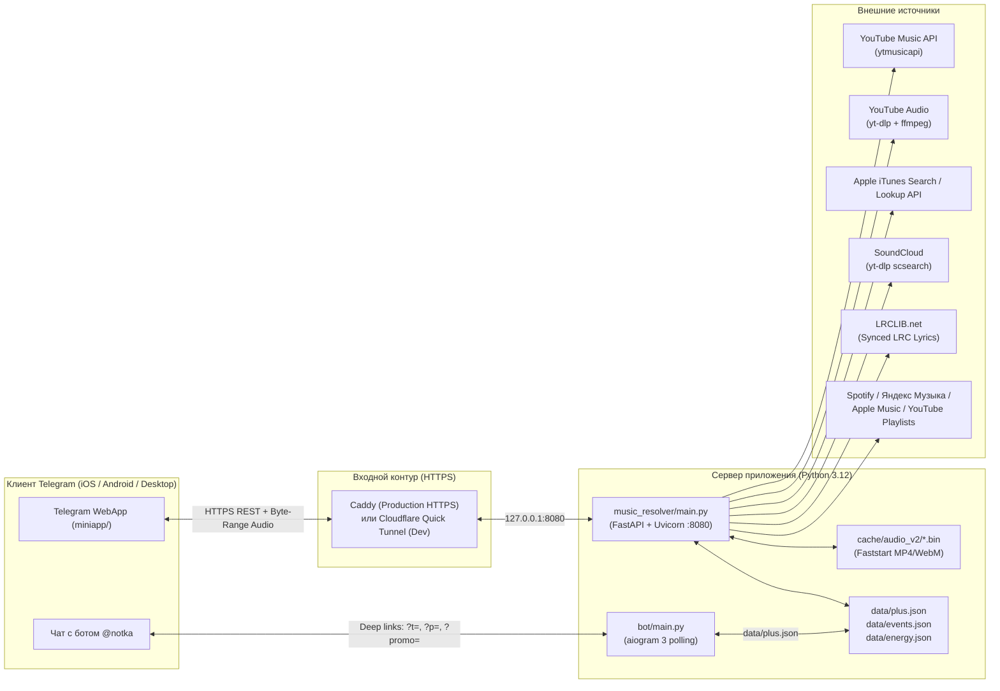

# Полная техническая и продуктовая документация проекта «Нотка» (Notka)

**«Нотка» (`Notka`)** — это музыкальное Telegram Mini App приложение и полноценный бэкенд-резолвер аудиопотоков (`FastAPI` + `aiogram 3` + Vanilla JS/WebGL2/Canvas2D), спроектированное как нативный мобильный музыкальный плеер внутри Telegram без рекламы, с поддержкой фонового воспроизведения, караоке-текстов, генератора миксов по настроению (с анализом аудио-энергетики через `ffmpeg`), импорта плейлистов из Spotify / Яндекс Музыки / Apple Music / YouTube, сезонных игровых ивентов и подписки **Нотка Плюс**.

---

## Содержание

1. [Обзор архитектуры и режимов запуска](#1-обзор-архитектуры-и-режимов-запуска)
2. [Структура репозитория (карта файлов)](#2-структура-репозитория-карта-файлов)
3. [Конфигурация и переменные окружения](#3-конфигурация-и-переменные-окружения)
4. [Бэкенд `music_resolver`: ядро и модели данных](#4-бэкенд-music_resolver-ядро-и-модели-данных)
5. [HTTP API (`music_resolver/api/routes.py`) — все 20 эндпоинтов](#5-http-api-music_resolverapiroutespy--все-20-эндпоинтов)
6. [Провайдеры музыки и алгоритмы сопоставления треков](#6-провайдеры-музыки-и-алгоритмы-сопоставления-треков)
7. [Внутренние сервисы бэкенда (`music_resolver/services/`)](#7-внутренние-сервисы-бэкенда-music_resolverservices)
8. [Утилиты (`music_resolver/utils/`)](#8-утилиты-music_resolverutils)
9. [Telegram-бот (`bot/`)](#9-telegram-бот-bot)
10. [Фронтенд Telegram Mini App (`miniapp/`)](#10-фронтенд-telegram-mini-app-miniapp)
11. [Визуальные движки и дизайн-система «Живой свет»](#11-визуальные-движки-и-дизайн-система-живой-свет)
12. [Хранилища данных, кэши и персистентность](#12-хранилища-данных-кэши-и-персистентность)
13. [Деплой в продакшен (`deploy/`)](#13-деплой-в-продакшен-deploy)
14. [Тестирование и E2E-инфраструктура (`tests/`)](#14-тестирование-и-e2e-инфраструктура-tests)
15. [Известные особенности и технические нюансы](#15-известные-особенности-и-технические-нюансы)

---

## 1. Обзор архитектуры и режимов запуска

Система состоит из трёх тесно интегрированных контуров, работающих в рамках одного процесса/хоста:



### Три точки входа запуска

| Сценарий | Скрипт запуска | Как работает |
| :--- | :--- | :--- |
| **Локальный запуск на Windows (в 1 клик)** | `start.bat` $\rightarrow$ `run_notka.py` | 1. Читает `.env`.<br>2. Выставляет `YTDLP_COOKIES_FROM_BROWSER=chrome` по умолчанию.<br>3. Поднимает FastAPI (`music_resolver.main:app`) + статику `/app` (`miniapp/`) на `127.0.0.1:8080` в фоновом daemon-потоке.<br>4. Поднимает публичный HTTPS-туннель `*.trycloudflare.com` через `pycloudflared`.<br>5. Запускает `python -m bot.main` дочерним процессом с `MINIAPP_URL=https://<tunnel>.trycloudflare.com/app/`. |
| **Продакшен-сервер (Ubuntu 22.04/24.04)** | `run_server.py` (под `systemd` сервисом `notka`) | 1. Формирует `MINIAPP_URL=${PUBLIC_URL}/app/`.<br>2. Монтирует `miniapp/` на `/app`, вешает middleware `Cache-Control: no-cache` на `/app/*` (чтобы клиенты Telegram не залипали на старом JS/CSS).<br>3. В фоновом потоке `_run_bot_forever()` супервайзит `python -m bot.main`: если бот падает после $>60\text{ с}$ аптайма — перезапуск через $5\text{ с}$, иначе — через $30\text{ с}$. Отключается при `RUN_BOT=0`.<br>4. В главном потоке крутит `uvicorn` на `HOST:PORT` (`127.0.0.1:8080`) за `Caddy`. |
| **Локальный тестовый стенд (E2E / UI)** | `tests/serve_local.py` | Запускает FastAPI + `/app` на `127.0.0.1:8099` без бота и без туннеля, изолируя ивенты во временной папке (`NOTKA_EVENTS_DIR`), фиксируя тестового пользователя `NOTKA_TEST_USER=424242` и дату `NOTKA_FAKE_NOW=2026-10-22` (разгар Хэллоуин-ивента). |

---

## 2. Структура репозитория (карта файлов)

```text
notka/
├── README.md                        # Краткая инструкция по установке и запуску
├── DOCS.md                          # Полная документация проекта (этот файл)
├── PROJECT_INDEX.md                 # Навигационный индекс репозитория
├── PRODUCT.md                       # Продуктовый паспорт, позиционирование, ЦА, роадмап фич
├── DESIGN.md                        # Спецификация дизайн-системы «Живой свет» (Living Light)
├── ROADMAP.md                       # Операционный трекер задач для AI-агентов
├── ЗАПУСК.txt                       # Краткая памятка запуска на русском для Windows
├── requirements.txt                 # Зависимости Python
├── start.bat                        # Windows-лаунчер для локального запуска
├── run_notka.py                     # Локальный оркестратор (FastAPI + Cloudflare Tunnel + Bot)
├── run_server.py                    # Продакшен-оркестратор (FastAPI + супервайзер бота)
│
├── bot/                             # Telegram-бот (aiogram 3.x)
│   ├── __init__.py
│   ├── config.py                    # BotSettings (BOT_TOKEN, MINIAPP_URL)
│   └── main.py                      # Хэндлеры /start (deep links), /id, /promo (админка Плюса)
│
├── music_resolver/                  # Бэкенд FastAPI и движок резолвинга музыки
│   ├── __init__.py
│   ├── main.py                      # Инициализация FastAPI, CORS, обработчики ошибок
│   ├── config.py                    # Settings + автопроверка живости прокси (_usable_proxy)
│   ├── models.py                    # Pydantic-схемы треков, альбомов, артистов и ответов API
│   ├── errors.py                    # Коды ошибок ErrorCode и класс AppError
│   ├── api/
│   │   ├── __init__.py
│   │   └── routes.py                # Все 20 HTTP-эндпоинтов, аудио-кэш /prepare, стриминг
│   ├── providers/
│   │   ├── __init__.py
│   │   ├── base.py                  # Абстрактный интерфейс BaseProvider
│   │   ├── youtube_common.py        # Общая обвязка yt-dlp (поиск, экстракт, фильтрация мусора)
│   │   ├── youtube_music.py         # Основной провайдер YouTube Music (ytmusicapi + yt-dlp + iTunes)
│   │   ├── itunes_catalog.py        # Каталог Apple iTunes + 3-ступенчатый матчинг в YouTube аудио
│   │   ├── soundcloud.py            # Провайдер SoundCloud через yt-dlp scsearch
│   │   └── youtube_web.py           # Провайдер обычного YouTube через yt-dlp ytsearch
│   ├── services/
│   │   ├── __init__.py
│   │   ├── factory.py               # Сборка графа зависимостей build_music_service()
│   │   ├── music_service.py         # Фасад MusicService с in-memory TTL-кэшированием
│   │   ├── provider_manager.py      # Параллельный опрос провайдеров, дедупликация, ранжирование
│   │   ├── matcher.py               # Скоринг релевантности треков (score_track, clean_text)
│   │   ├── mood_mix.py              # Генератор миксов по настроению и персональным сигналам
│   │   ├── energy.py                # Ffmpeg PCM-анализатор аудио-энергетики (loud/punch/bright/tempo)
│   │   ├── lyrics.py                # Поиск синхронных LRC и обычных текстов (LRCLIB + YT Music)
│   │   ├── playlist_import.py       # Импорт плейлистов из Spotify, Яндекс Музыки, Apple Music, YT
│   │   ├── plus_store.py            # Хранилище подписок Нотка Плюс, промокодов и проверка HMAC initData
│   │   └── events_store.py          # Движок сезонных ивентов (Хэллоуин), заданий и наград
│   └── utils/
│       ├── __init__.py
│       ├── ids.py                   # Сборка и парсинг составных ID "source:source_id"
│       ├── logging.py               # Настройка логгера
│       └── remux.py                 # Дефрагментация MP4 (ffmpeg -movflags +faststart) для WebView
│
├── miniapp/                         # Фронтенд Telegram Mini App (Vanilla JS / CSS / WebGL2)
│   ├── index.html                   # Разметка 21 экрана, нижнего дока, мини-плеера и 14 модалок/шитов
│   ├── config.js                    # Конфигурация window.NOTKA_CONFIG (API_BASE)
│   ├── app.js                       # Главный контроллер (~4800 строк: стейт, аудио, UI, роутинг)
│   ├── styles.css                   # Основные стили дизайн-системы «Живой свет»
│   ├── atmosphere.css               # Стили канвасов сезонной атмосферы
│   ├── events.css                   # Стили экрана ивентов, карточек заданий и тыквы
│   ├── prism.js                     # WebGL2 шейдер призматического преломления света (window.Prism)
│   ├── shredder.js                  # Физический бумажный шредер для удаления треков (window.Shredder)
│   ├── atmosphere.js                # Двухслойный генератор сезонных частиц и гирлянды (window.Atmosphere)
│   ├── pumpkin.js                   # Интерактивная SVG-тыква из жидкого стекла (window.PumpkinArt)
│   └── icons/                       # Ассеты иконок приложения
│
├── deploy/                          # Скрипты продакшен-деплоя на VPS
│   ├── README.md                    # Инструкция по развёртыванию и эксплуатации VPS
│   ├── setup.sh                     # Автоустановщик на чистую Ubuntu (Caddy, Node, Python, systemd)
│   └── push.sh                      # Скрипт деплоя обновлений с локальной машины по SSH/SCP
│
└── tests/                           # Тесты и браузерная автоматизация
    ├── serve_local.py               # Локальный тестовый сервер (:8099) с фейковым временем и юзером
    ├── cdp.mjs                      # Минималистичный клиент Chrome DevTools Protocol поверх Node 22 WebSocket
    ├── e2e.mjs                      # Полный E2E-прогон (38 проверок) в headless Chrome/Edge
    └── events_store_test.py         # Юнит-тесты движка сезонных ивентов (10 сценариев)
```

---

## 3. Конфигурация и переменные окружения

Конфигурация считывается из `.env` (через `python-dotenv`) в `music_resolver/config.py` (`get_settings()`) и `bot/config.py` (`get_bot_settings()`).

### Полная таблица переменных окружения

| Переменная | По умолчанию | Где используется | Описание |
| :--- | :--- | :--- | :--- |
| `BOT_TOKEN` | *(обязательна для бота)* | `bot/config.py`, `plus_store.py`, `routes.py` | Токен Telegram-бота от `@BotFather`. Также используется бэкендом для проверки подписи `X-Telegram-Init-Data` и вызова `getMe` в `/bot-info`. |
| `ADMIN_IDS` | `""` | `bot/main.py` | Список Telegram ID администраторов через запятую или пробел (например, `123456789,987654321`). Даёт доступ к команде `/promo`. |
| `PUBLIC_URL` | `http://localhost:8080` | `run_server.py` | Публичный HTTPS-домен сервера (без слэша на конце), из которого формируется `MINIAPP_URL=${PUBLIC_URL}/app/`. |
| `MINIAPP_URL` | авто | `bot/config.py`, `run_notka.py`, `run_server.py` | Полный URL веб-приложения. Выставляется автоматически лаунчерами (`run_notka.py` или `run_server.py`). |
| `RUN_BOT` | `1` | `run_server.py` | Если `0`, `false` или `no` — `run_server.py` запускает только HTTP-сервер без встроенного поллинга бота. |
| `HOST` | `127.0.0.1` | `music_resolver/config.py`, `run_server.py` | Хост привязки `uvicorn`. |
| `PORT` | `8080` | `music_resolver/config.py`, `run_notka.py`, `run_server.py` | Порт HTTP-сервера. |
| `LOG_LEVEL` | `INFO` | `music_resolver/config.py` | Уровень логирования (`DEBUG`, `INFO`, `WARNING`, `ERROR`). |
| `SEARCH_DEFAULT_LIMIT` | `5` | `music_resolver/config.py` | Лимит выдачи `/search` по умолчанию. |
| `SEARCH_MAX_LIMIT` | `20` | `music_resolver/config.py` | Максимально допустимый `limit` в `/search`. |
| `SEARCH_CANDIDATES_PER_PROVIDER` | `5` | `music_resolver/config.py` | Сколько кандидатов запрашивать у каждого провайдера при поиске. |
| `PROVIDER_TIMEOUT_SECONDS` | `20.0` | `music_resolver/config.py` | Таймаут сетевых операций провайдеров (сек). |
| `SEARCH_CACHE_TTL_SECONDS` | `300` | `music_resolver/config.py` | Время жизни кэша поисковых запросов (5 минут). |
| `RESOLVE_CACHE_TTL_SECONDS` | `900` | `music_resolver/config.py` | Время жизни кэша резолвинга треков (15 минут). |
| `CACHE_MAX_ITEMS` | `512` | `music_resolver/config.py` | Максимальное число элементов в in-memory `TTLCache`. |
| `AUDIO_CACHE_MAX_MB` | `2048` | `music_resolver/api/routes.py` | Максимальный размер дискового кэша аудиофайлов в `cache/audio_v2/` (в мегабайтах). При превышении старые файлы удаляются по LRU (`mtime`). |
| `STREAM_CHUNK_SIZE` | `65536` | `music_resolver/config.py` | Размер чанка при потоковой передаче (64 КБ). |
| `YTDLP_PROXY` | `None` | `music_resolver/config.py` | HTTP/SOCKS прокси для `yt-dlp`, `ytmusicapi` и `iTunes`. Проходит автопроверку живости при старте. |
| `ITUNES_PROXY` | `=YTDLP_PROXY` | `music_resolver/config.py` | Отдельный прокси для `ITunesCatalogProvider` (по умолчанию наследует `YTDLP_PROXY`). |
| `YTMUSIC_PROXY` | `=YTDLP_PROXY` | `music_resolver/config.py` | Отдельный прокси для `ytmusicapi` (по умолчанию наследует `YTDLP_PROXY`). |
| `YTDLP_COOKIES_FILE` | `None` | `music_resolver/config.py` | Путь к файлу `cookies.txt` в формате Netscape для обхода антибот-защиты YouTube. |
| `YTDLP_COOKIES_FROM_BROWSER` | `None` (`chrome` в `run_notka.py`) | `music_resolver/config.py` | Имя браузера (`chrome`, `edge`, `firefox`), из которого `yt-dlp` будет брать куки локально. |
| `NOTKA_ALLOW_UNVERIFIED` | `0` | `music_resolver/services/plus_store.py` | Только для dev: если `1`, принимает заголовок `X-Telegram-User-Id` без криптографической проверки `X-Telegram-Init-Data`. |
| `NOTKA_TEST_USER` | `""` | `music_resolver/services/events_store.py` | Только для E2E-тестов: подменяет ID пользователя в `/events*`, если нет `initData`. |
| `NOTKA_FAKE_NOW` | `""` | `music_resolver/services/events_store.py` | Только для тестов: фиксирует текущую дату `YYYY-MM-DD` в движке сезонных ивентов. |
| `NOTKA_EVENTS_DIR` | `data/` | `music_resolver/services/events_store.py` | Папка хранения `events.json` (переопределяется в тестах). |
| `NOTKA_PLUS_DIR` | `data/` | `music_resolver/services/plus_store.py` | Папка хранения `plus.json`. |

### Автоматическая проверка прокси (`_usable_proxy`)
В `music_resolver/config.py` функция `_usable_proxy(url)` (строки 11–32) при старте приложения делает пробный запрос к `https://music.youtube.com/` через указанный прокси с таймаутом $8\text{ с}$ (с фоллбэком на `curl`). Если локальный прокси (например, выключенный `127.0.0.1:10808`) не отвечает, он **автоматически отключается** с предупреждением в лог, чтобы не обрушить работу всех провайдеров. Настройки кэшируются синглтоном `_CACHED_SETTINGS`.

---

## 4. Бэкенд `music_resolver`: ядро и модели данных

### Инициализация приложения (`music_resolver/main.py`)
- Создаёт экземпляр `FastAPI(title="Telegram Mini App Music Resolver", version="0.1.0")`.
- Подключает `CORSMiddleware` с `allow_origins=["*"]`, `allow_methods=["*"]`, `allow_headers=["*"]`.
- Регистрирует глобальные обработчики исключений:
  - `AppError` $\rightarrow$ возвращает JSON `{"error": {"code": exc.code, "message": exc.message, "details": exc.details}}` со статусом из `ERROR_STATUS_BY_CODE`.
  - `Exception` $\rightarrow$ логирует стектрейс и возвращает HTTP `500` (`PROVIDER_UNAVAILABLE`, `"Internal server error"`).

### Коды ошибок (`music_resolver/errors.py`)

| Код (`ErrorCode`) | HTTP-статус | Когда возникает |
| :--- | :---: | :--- |
| `INVALID_QUERY` | `400` | Пустой поисковый запрос, некорректный составной ID, неверный промокод или пустой список сидов в `/mood`. |
| `INVALID_SOURCE_URL` | `400` | Неподдерживаемая ссылка в `/import` или отсутствие `url` в `/stream` при `id=None`. |
| `TRACK_NOT_FOUND` | `404` | Трек не найден у провайдера или общий плейлист `/shared/{id}` не существует. |
| `ALBUM_NOT_FOUND` | `404` | Альбом не найден у провайдера. |
| `ARTIST_NOT_FOUND` | `404` | Артист не найден у провайдера. |
| `RESOLVE_FAILED` | `502` | Не удалось извлечь прямую аудио-ссылку или скачать аудиофайл через `yt-dlp`/апстрим. |
| `PROVIDER_UNAVAILABLE` | `503` | Внешний провайдер недоступен или вернул ошибку парсинга. |
| `TIMEOUT` | `504` | Превышен таймаут ожидания провайдера (`PROVIDER_TIMEOUT_SECONDS`). |

### Формат идентификаторов (`music_resolver/utils/ids.py`)
Внутренние и публичные идентификаторы треков, альбомов и артистов всегда имеют вид:
```text
{source}:{source_id}
```
Например:
- `youtube_music:dQw4w9WgXcQ`
- `itunes:1440857781`
- `soundcloud:987654321`
- `youtube:dQw4w9WgXcQ`

Функция `build_public_id(source, source_id)` склеивает их, а `parse_public_id(raw_id)` валидирует и разделяет обратно, выбрасывая `AppError(ErrorCode.INVALID_QUERY)` при нарушении формата.

### Модели данных (`music_resolver/models.py`)

1. **`TrackCandidate`** — внутренний кандидат при поиске и ранжировании:
   - `source: str`, `source_id: str`, `title: str`, `artist: str`, `duration: int | None`, `cover_url: str | None`, `source_url: str`, `is_Playable: bool = True`, `quality_hint: str | None`, `raw_extra: dict`, `album_name: str | None`, `album_id: str | None`, `artist_id: str | None`.
2. **`TrackInfo`** — публичная карточка трека в ответах API:
   - `id: str` (`source:source_id`), `source: str`, `source_id: str`, `title: str`, `artist: str`, `duration: int | None`, `cover: str | None`, `album_name: str | None`, `album_id: str | None`, `artist_id: str | None`.
   - Статический метод `TrackInfo.from_candidate(candidate)` конвертирует `TrackCandidate` в `TrackInfo`.
3. **`PlaybackInfo`** — параметры воспроизведения:
   - `status: str` (`"ready"`), `stream_url: str`, `expires_at: int | None`, `mime_type: str | None`, `bitrate: int | None`, `headers: dict[str, str]`.
4. **`ResolvedTrack`** — внутренний результат резолвинга:
   - `track: TrackCandidate`, `stream_url: str`, `expires_at: int | None`, `mime_type: str | None`, `bitrate: int | None`, `headers: dict[str, str]`.
5. **`AlbumSummary`** — краткая карточка альбома:
   - `id: str`, `source: str`, `source_id: str`, `title: str`, `artist: str`, `year: int | None`, `cover: str | None`, `track_count: int | None`.
6. **`AlbumInfo`** — полная страница альбома (наследует `AlbumSummary` + `tracks: list[TrackInfo]`).
7. **`ArtistInfo`** — полная страница артиста:
   - `id: str`, `source: str`, `source_id: str`, `name: str`, `avatar: str | None`, `subscribers: str | None`, `top_tracks: list[TrackInfo]`, `albums: list[AlbumSummary]`.

---

## 5. HTTP API (`music_resolver/api/routes.py`) — все 20 эндпоинтов

Все маршруты объявлены в `music_resolver/api/routes.py`. Ниже приведена полная спецификация каждого эндпоинта.

### 5.1. Диагностика и поиск

#### `GET /health`
Проверка работоспособности сервера.
- **Ответ `200 OK`**: `{"status": "ok"}`.

#### `GET /search`
Мультипровайдерный поиск треков с дедупликацией и скорингом.
- **Query-параметры**:
  - `q` *(обязательный, строка)* — поисковый запрос.
  - `limit` *(int, по умолчанию `SEARCH_DEFAULT_LIMIT=5`, макс. `20`)* — количество результатов.
- **Ответ `200 OK`** (`SearchResponse`):
  ```json
  {
    "query": "кино группа крови",
    "results": [
      {
        "id": "youtube_music:...",
        "source": "youtube_music",
        "source_id": "...",
        "title": "Группа крови",
        "artist": "КИНО",
        "duration": 285,
        "cover": "https://...",
        "album_name": "Группа крови",
        "album_id": "youtube_music:MPREb_...",
        "artist_id": "youtube_music:UC..."
      }
    ]
  }
  ```

#### `GET /artists`
Поиск карточек артистов через `YoutubeMusicProvider.search_artists`.
- **Query-параметры**: `q` *(строка)*, `limit` *(int, 1..20, по умолчанию `8`)*.
- **Ответ `200 OK`**:
  ```json
  {
    "query": "кино",
    "results": [
      {
        "id": "youtube_music:UC...",
        "source": "youtube_music",
        "source_id": "UC...",
        "name": "КИНО",
        "avatar": "https://...",
        "subscribers": "1.2M"
      }
    ]
  }
  ```

### 5.2. Каталог, резолвинг и аудио-стриминг

#### `GET /resolve`
Резолвинг метаданных трека и прямой ссылки на апстрим-поток.
- **Query-параметры**: `source` *(опционально)*, `id` *(составной `source:id` или чистый `id` при наличии `source`)*, `url` *(опционально, прямая ссылка)*.
- **Ответ `200 OK`** (`ResolveResponse`): содержит `track` (`TrackInfo`) и `playback` (`PlaybackInfo`, где `stream_url` указывает на `/stream?source=...&id=...`).

#### `GET /album` и `GET /artist`
Получение полной страницы альбома (`AlbumInfo`) или артиста (`ArtistInfo` с топ-треками и дискографией).
- **Query-параметры**: `id` *(например, `youtube_music:MPREb_...` или `itunes:12345`)*, `source` *(опционально)*.

#### `GET /prepare`
Предварительное скачивание, дефрагментация и кэширование аудиофайла на диск сервера (`cache/audio_v2/{source}_{id}.bin`).
- **Зачем нужен**: YouTube отдаёт аудио в виде фрагментированного MP4 (DASH). Встроенный WebView Telegram на Android/iOS часто обрывает звук ровно через 10 секунд (после первого фрагмента `moof`/`mdat`), если файл стримится напрямую. `/prepare` скачивает аудио целиком, прогоняет через `remux_to_faststart()` (`ffmpeg -c copy -movflags +faststart`) и сохраняет в локальный кэш.
- **Механизм дедупликации**: если два запроса одновременно обращаются к одному и тому же `key`, второй ждёт завершения первого через `asyncio.Lock` в словаре `_download_locks`.
- **Порядок скачивания (`_ensure_cached`)**:
  1. Для `youtube_music` / `youtube` сначала вызывается быстрый прямой downloader `YoutubeCommon.download_to_file()` через `yt-dlp`.
  2. Если не вышло — запрашивается `service.resolve()` и поток качается через `httpx.AsyncClient` с заголовками апстрима.
  3. Выполняется `remux_to_faststart(tmp_path)` в `ThreadPoolExecutor`.
  4. Атомарная замена `os.replace` в `{key}.bin` и запись MIME-типа в `{key}.mime`.
  5. Вызов `_maybe_prune_cache()` в фоновом таске (очистка старых файлов при превышении `AUDIO_CACHE_MAX_MB = 2048 МБ`).
- **Ответ `200 OK`**:
  ```json
  {
    "ready": true,
    "stream_url": "/stream?source=youtube_music&id=dQw4w9WgXcQ",
    "size": 3412984,
    "mime_type": "audio/mp4"
  }
  ```

#### `GET /stream`
Отдача подготовленного аудиофайла плееру с полной поддержкой HTTP `Range` запросов (`Accept-Ranges: bytes`, `Content-Length`) через `FileResponse` из Starlette.
- **Query-параметры**: `source`, `id`, `url`, `mode` (`proxy` по умолчанию | `redirect` | `json`).
- **Заголовки ответа**: `Cache-Control: no-store`.

#### `GET /download`
Скачивание аудиофайла пользователем (функция Нотка Плюс / экспорт файла).
- Вызывает `_ensure_cached()`, определяет расширение (`.m4a`, `.webm`, `.mp3`, `.ogg`) и формирует имя файла `{Artist} - {Title}.{ext}` с безопасным ASCII-фоллбэком и `filename*=UTF-8''...` по RFC 5987.

### 5.3. Персонализация, тексты песен и импорт

#### `GET /radio`
Бесконечное радио («Моя волна» / автопродолжение очереди) на базе сид-трека.
- **Query-параметры**: `id` *(обязательный)*, `source` *(опционально)*, `limit` *(1..50, по умолчанию `25`)*.
- Вызывает `YoutubeMusicProvider.get_radio(video_id, limit)` (`ytmusic.get_watch_playlist(videoId, radio=True)`).
- **Ответ `200 OK`**: `{"seed": "youtube_music:...", "results": [TrackInfo, ...]}`.

#### `POST /mood`
Генерация умного микса по выбранному настроению и локальной истории слушателя.
- **Тело запроса (`MoodRequest`)**:
  ```json
  {
    "mood": "energetic",
    "seeds": [{"id": "youtube_music:...", "artist": "...", "title": "..."}],
    "top_artists": ["КИНО", "Молчат Дома"],
    "exclude_ids": ["youtube_music:..."],
    "limit": 25
  }
  ```
- Поддерживаемые режимы `mood`: `"energetic"` (Бодрый), `"happy"` (Весёлый), `"calm"` (Спокойный), `"sad"` (Грустный).
- **Ответ `200 OK`**: `{"mood": "energetic", "results": [TrackInfo, ...]}`.

#### `GET /lyrics`
Получение синхронизированного (LRC с таймкодами) или обычного текста песни.
- **Query-параметры**: `title`, `artist`, `duration` *(опционально, сек)*, `source` *(опционально)*, `id` *(опционально)*.
- **Ответ `200 OK`**:
  ```json
  {
    "found": true,
    "source": "lrclib",
    "synced": true,
    "plain": "...",
    "lines": [
      {"time": 12.45, "text": "Теплое место, но улицы ждут"}
    ]
  }
  ```

#### `GET /import`
Универсальный импорт публичных плейлистов и альбомов по ссылке.
- **Query-параметры**: `url` *(ссылка на Spotify, Яндекс Музыку, Apple Music или YouTube / YouTube Music)*.
- **Ответ `200 OK`**:
  ```json
  {
    "source": "spotify",
    "title": "Мой плейлист",
    "cover": "https://...",
    "total": 42,
    "tracks": [
      {"title": "...", "artist": "...", "duration": 210, "cover": "https://..."}
    ]
  }
  ```
  *(Примечание: `/import` возвращает метаданные треков быстро; далее фронтенд резолвит их через `/search` пачками с прогресс-баром).*

### 5.4. Подписка Нотка Плюс, Ивенты и Шеринг

#### `GET /plus/status`
Проверка статуса подписки **Нотка Плюс** текущего пользователя.
- **Заголовки**: `X-Telegram-Init-Data` *(подписанная строка `Telegram.WebApp.initData`)* или `X-Telegram-User-Id` *(только если `NOTKA_ALLOW_UNVERIFIED=1`)*.
- **Ответ `200 OK`**:
  ```json
  {
    "active": true,
    "until": 1765000000,
    "days_left": 14,
    "source": "promo:FRIEND2026",
    "verified": true
  }
  ```

#### `POST /plus/redeem`
Активация промокода на Нотка Плюс.
- **Заголовки**: `X-Telegram-Init-Data` *(обязательна криптографическая проверка подписи Telegram)*.
- **Тело запроса**: `{"code": "NOTKA30"}`.
- **Защита от перебора**: не более 10 попыток ввода в час на один `user_id` (`_check_redeem_rate`).

#### `GET /events`, `POST /events/sync`, `POST /events/advance`, `POST /events/reset`
API сезонных ивентов (`music_resolver/services/events_store.py`).
- `GET /events` — возвращает список активных ивентов, прогресс пользователя, открытые по дню задания, полученные награды и разблокированную косметику (`unlocked_cosmetics`).
- `POST /events/sync` — принимает накопленный на клиенте прогресс (`{"event_id": "halloween", "progress": {...}, "claimed": [...]}`), мержит его по максимуму (`max(cur, val)`), начисляет награды (включая реальные дни **Нотка Плюс** через `plus_store.grant_days`) и сохраняет на сервере.
- `POST /events/advance` — инкрементирует прогресс конкретного задания (`{"event_id": "halloween", "task_id": "catch_bats", "delta": 1}`).
- `POST /events/reset` — сбрасывает прогресс пользователя по ивенту и отзывает ранее выданные за этот ивент дни Плюса (`plus_store.revoke_days`).

#### `GET /bot-info`
Возвращает username Telegram-бота (кэшируется в памяти после первого вызова `https://api.telegram.org/bot<TOKEN>/getMe`), чтобы фронтенд мог строить deep-link ссылки `https://t.me/<bot>?start=...`.

#### `POST /shared` и `GET /shared/{share_id}`
Серверное хранилище расшаренных плейлистов (`cache/shared/{share_id}.json`).
- `POST /shared` принимает `{"name": "...", "emoji": "🔥", "cover": "...", "owner": "...", "tracks": [...]}` (до 300 треков), генерирует 9-символьный base62 `share_id` (или детерминированный SHA1-хэш `u{11 символов}` от `owner + name`, чтобы повторный шеринг того же плейлиста обновлял ту же ссылку) и возвращает `{"id": share_id}`.
- `GET /shared/{share_id}` отдаёт сохранённый JSON плейлиста, когда другой пользователь открывает ссылку `https://t.me/<bot>?start=p_<share_id>`.

---

## 6. Провайдеры музыки и алгоритмы сопоставления треков

Все провайдеры наследуют абстрактный класс `BaseProvider` (`music_resolver/providers/base.py`) и инстанцируются в `build_music_service()` (`music_resolver/services/factory.py`).

### 6.1. Сравнительная таблица провайдеров

| Провайдер (`name`) | Класс и файл | Участвует в `/search` | Приоритет в `PROVIDER_ORDER` | Как ищет метаданные | Как добывает аудиопоток |
| :--- | :--- | :---: | :---: | :--- | :--- |
| **`youtube_music`** | `YoutubeMusicProvider`<br>(`providers/youtube_music.py`) | Да | **1 (высший)** | `ytmusicapi.YTMusic.search(filter="songs")` + `search(filter="videos")` | `YoutubeCommon.extract_info(video_id)` через `yt-dlp` (`bestaudio[ext=m4a]/bestaudio[acodec^=mp4a]/bestaudio/best`). |
| **`soundcloud`** | `SoundCloudProvider`<br>(`providers/soundcloud.py`) | Да | **2** | `yt-dlp` `scsearch{limit}:{query}` (`extract_flat=True`) | `yt-dlp` по URL трека на `soundcloud.com`. |
| **`youtube`** | `YoutubeWebProvider`<br>(`providers/youtube_web.py`) | Да | **3** | `yt-dlp` `ytsearch{limit}:{query}` | `YoutubeCommon.extract_info()` через `yt-dlp`. |
| **`itunes`** | `ITunesCatalogProvider`<br>(`providers/itunes_catalog.py`) | Только каталог / матчинг | Резолв по ID и дискографии артистов | Apple iTunes Search & Lookup API (`itunes.apple.com`, `country=RU`) | **3-ступенчатый матчинг** (`_match_audio`) в YouTube Music / YouTube Web. |

### 6.2. `YoutubeCommon` (`music_resolver/providers/youtube_common.py`)
Общий низкоуровневый адаптер к `yt-dlp`:
- **Формат выбора аудио**: `"bestaudio[ext=m4a]/bestaudio[acodec^=mp4a]/bestaudio/best"` — приоритет отдаётся AAC в контейнере M4A, так как он идеально воспроизводится как на iOS Safari WebView, так и на Android Chromium WebView.
- **Фильтрация нерелевантных видео (`is_bad_music_candidate`)**: отсекает ролики длиннее 15 минут (`>900 с`), а также результаты со словами `karaoke`, `караоке`, `минус`, `instrumental`, `live`, `concert`, `reaction`, `review`, `cover`, `кавер`, `tutorial`, `lesson`, `разбор`, `1 hour`, `10 hours`, `full album`, `stream` — если только сам пользователь явно не ввёл эти слова в поисковый запрос.
- **Автовосстановление при протухших cookies**: если `yt-dlp` падает с куками (например, сессия YouTube истекла или заблокирована), `extract_info` и `download_to_file` автоматически делают повторную попытку в «чистом» режиме (`_fresh_opts(use_cookies=False)`).
- **Быстрое скачивание (`download_to_file`)**: качает медиапоток напрямую на диск через `yt-dlp` в пуле потоков (`_DL_EXECUTOR`, 6 воркеров).

### 6.3. `YoutubeMusicProvider` (`music_resolver/providers/youtube_music.py`)
Основной поставщик музыки в «Нотке»:
- **Поиск (`search`)**: если запрос длиннее 3 символов, параллельно запускает в `asyncio.gather` два запроса к `ytmusicapi`:
  1. Официальный каталог песен (`filter="songs"`, помечается `quality_hint="ytm_song"`).
  2. Музыкальные видео и неофициальные релизы (`filter="videos"`, помечается `quality_hint="ytm_video"`), чтобы находить анрелизы, ремиксы, SoundCloud-рипы и локальные треки, которых нет в стриминговом каталоге песен.
- **Апскейл обложек (`_upscale_thumb`)**: автоматически переписывает параметры Google-тамбнейлов `=w120-h120-` $\rightarrow$ `=w544-h544-` для чётких обложек в плеере.
- **Обогащение дискографии артистов (`get_artist`)**: YouTube Music часто возвращает неполный список альбомов или смешивает синглы с альбомами. Поэтому `get_artist()` параллельно (с таймаутом $8\text{ с}$) запрашивает `ITunesCatalogProvider.albums_for_artist_name(name)` и подменяет витрину альбомов артиста чистой дискографией из Apple Music / iTunes, сохраняя фоллбэк на собственные альбомы YouTube Music.

### 6.4. `ITunesCatalogProvider` и 3-ступенчатый алгоритм `_match_audio` (`music_resolver/providers/itunes_catalog.py`)
Поскольку iTunes API отдаёт только 30-секундные превью, при открытии трека или альбома из каталога `itunes` метод `_match_audio(track)` находит полную аудиодорожку в YouTube в три прохода:
1. **Проход 1 (Точный поиск песни в YT Music)**: ищет `"{artist} {title}"` через `ytmusic.search(filter="songs", limit=8)`. Выбирает лучший трек, если `score_track >= 55.0` и разница длительности с эталоном iTunes не превышает $12\text{ с}$.
2. **Проход 2 (Поиск по видео в YT Music)**: если песня не нашлась, ищет `filter="videos"`. Принимает кандидата при `score_track >= 45.0` и расхождении длительности $\le 20\text{ с}$.
3. **Проход 3 (Широкий поиск в YouTube Web через `yt-dlp`)**: вызывает `YoutubeCommon.search(f"{artist} - {title}", limit=5)`. Принимает лучший ролик с `score_track >= 35.0`.

Найденный `videoId` сохраняется в in-memory кэше `_audio_match_cache` (`itunes_track_id -> ResolvedTrack`), чтобы повторные обращения не делали лишних поисковых запросов.

### 6.5. Ранжирование и дедупликация (`ProviderManager` + `matcher.py`)
Когда пользователь вводит запрос в `/search`:
1. `ProviderManager.search()` (`music_resolver/services/provider_manager.py`) параллельно опрашивает `youtube_music`, `soundcloud` и `youtube` с индивидуальным таймаутом `provider_timeout_seconds`.
2. **Дедупликация (`_deduplicate`)**: схлопывает дубликаты по ключу `(clean_text(artist), clean_text(title), round(duration / 3))`.
3. **Скоринг (`score_track` в `music_resolver/services/matcher.py`)**:
   - Текст очищается через `clean_text()` (приведение к нижнему регистру, `ё -> е`, удаление скобок `(feat. ...)` при расчёте базового совпадения).
   - Считается гибридный балл `rapidfuzz`: `0.6 * token_set_ratio + 0.4 * partial_ratio` по паре `artist + title` плюс бонусы за совпадение `title` (`0.25 * token_set_ratio`) и `artist` (`0.15 * token_set_ratio`).
   - **Бонусы**:
     - $+25$ баллов, если название трека начинается с запроса или полностью совпадает с ним, либо артист точно равен запросу.
     - $+18$ баллов за `quality_hint == "ytm_song"` (официальный аудио-релиз в YouTube Music).
     - $+12$ баллов за наличие `cover_url` и альбомных метаданных (`album_id`).
     - $+5$ баллов за наличие известной длительности (`duration`).
   - **Штрафы за мусорные версии** (если сам пользователь **не** просил их в запросе):
     - $-35$ баллов за слова из `JUNK_WORDS` (`live`, `cover`, `кавер`, `karaoke`, `караоке`, `instrumental`, `минус`, `reaction`, `review`, `tutorial`, `8d`, `bass boosted`, `parody`).
     - $-22$ балла за непрошенные модификаторы версий (`slowed`, `reverb`, `sped up`, `nightcore`, `phonk remix`, `mashup`, `acoustic`).
     - $-40$ баллов за треки длиннее 12 минут (`>720 с`) или $-15$ баллов за треки длиннее 8 минут (`>480 с`).
     - $-50$ баллов за короткие огрызки/превью короче 35 секунд (`<35 с`).

---

## 7. Внутренние сервисы бэкенда (`music_resolver/services/`)

### 7.1. Анализ аудио-энергетики (`music_resolver/services/energy.py`)
Модуль `energy.py` измеряет **реальный акустический характер** трека по его скачанному аудиофайлу в `cache/audio_v2/{key}.bin`:
- Декодирует 40 секунд аудио (пропуская первые 25 секунд интро: `-ss 25 -t 40`) в сырой моно-поток `s16le` с частотой дискретизации $8000\text{ Гц}$ через `ffmpeg`.
- Разбивает сигнал на окна по $50\text{ мс}$ (400 сэмплов) и вычисляет 4 физические метрики в диапазоне $[0..1]$:
  1. `loud` — среднеквадратичная громкость (RMS в дБ, нормализованная от $-32\text{ дБ}$ до $-8\text{ дБ}$).
  2. `punch` — перцентиль P90 положительных скачков огибающей громкости (острота транзиентов и бочки/бита).
  3. `bright` — Zero-Crossing Rate (ZCR, частота пересечения нуля), отражающая насыщенность высокими частотами и перкуссией.
  4. `tempo` — плотность пиков онсетов в секунду (оценка темпа от $\sim 60$ до $\sim 180\text{ BPM}$).
- Итоговый индекс энергии вычисляется по формуле:
  $$\text{energy} = 0.30 \cdot \text{loud} + 0.35 \cdot \text{punch} + 0.20 \cdot \text{tempo} + 0.15 \cdot \text{bright}$$
- Все замеры сохраняются на диск в `data/energy.json`, поэтому каждый трек анализируется за $\sim 80\text{ мс}$ только один раз в жизни.
- Функция `mood_fit_from_features(feat, mood)` возвращает коэффициент соответствия трека выбранному настроению (`energetic`, `calm`, `sad`, `happy`), который используется генератором миксов.

### 7.2. Генератор миксов по настроению (`music_resolver/services/mood_mix.py`)
Функция `build_mood_mix()` строит персонализированный микс в 3 этапа:
1. **Сбор кандидатов из вкуса пользователя**:
   - Берёт до 6 случайных сид-треков из избранного/истории пользователя и запрашивает для каждого `YoutubeMusicProvider.get_radio(vid, limit=18)` (параллельно до 4 потоков).
   - Берёт до 3 любимых артистов пользователя и ищет треки по запросам `"{artist} {mood_modifier}"` (например, `"КИНО акустика спокойная"` для `calm` или `"КИНО бодрый бит драйв"` для `energetic`).
   - Если у нового пользователя совсем нет истории, добирает базовые запросы из `FALLBACK_QUERIES[mood]`.
2. **Фильтрация (`_is_junk`)**:
   - Выбрасывает треки короче $65\text{ с}$ и длиннее $540\text{ с}$, часовые компиляции (`1 hour`, `mix`, `playlist`, `сборник`), детские песенки и белый шум (`lullaby`, `white noise`, `rain sounds`).
   - Для каждого настроения применяет стоп-слова `MOOD_CONFLICT` (например, в `calm` блокируются `phonk`, `hardstyle`, `metal`, `rave`, а в `energetic` блокируются `acoustic`, `piano`, `ambient`, `lofi`, `sleep`).
3. **Скоринг (`_mood_score`) и сборка с разнообразием артистов**:
   - Учитывает текстовые маркеры `MOOD_POSITIVE`, оптимальное окно длительности (`MOOD_DURATION_SWEET`), бонус знакомого артиста ($+0.8$) и акустический скоринг `energy.mood_fit()` по реальному аудиофайлу (или запуская `analyze_in_background` для будущих генераций).
   - Собирает итоговый список с ограничением **не более 2 треков одного артиста**, чтобы микс не превращался в сольный концерт одного исполнителя.

### 7.3. Сервис текстов песен (`music_resolver/services/lyrics.py`)
Функция `fetch_lyrics(title, artist, duration, ytm, video_id)`:
1. Очищает название и артиста от мусорных суффиксов (`Official Video`, `prod. by`, `feat.`, `[HD]`) через `_clean()`.
2. Проверяет файловый кэш `cache/lyrics/{sha1}.json`. Положительные ответы кэшируются бессрочно, отрицательные (`found: false`) — на 24 часа.
3. **Источник №1 — `LRCLIB` (`https://lrclib.net/api`)**:
   - Сначала вызывает точный `/api/get` (если передана длительность и она сходится с точностью до $\pm 3.0\text{ с}$).
   - Затем вызывает `/api/search?track_name=...&artist_name=...` и при неудаче общий `/api/search?q=...`.
   - Ранжирует кандидатов (`_pick_best`), отдавая приоритет записям с `syncedLyrics` (таймкоды `[mm:ss.xx]`).
   - Парсит LRC-строки регулярным выражением `_LRC_LINE_RE` в массив `[{"time": float_sec, "text": str}]`.
4. **Источник №2 — YouTube Music (`_from_ytmusic`)**:
   - Если в LRCLIB текста нет, обращается к `ytmusic.get_watch_playlist(videoId)` $\rightarrow$ `lyrics` browseId $\rightarrow$ `ytmusic.get_lyrics(browse_id)` и возвращает обычный (`synced: false`) текст песни.

### 7.4. Импорт внешних плейлистов (`music_resolver/services/playlist_import.py`)
Функция `import_playlist(url)` определяет платформу по URL и извлекает до `MAX_TRACKS = 300` треков без необходимости OAuth-авторизации:
- **Spotify (`open.spotify.com/{playlist|album|track}/{id}`)**:
  - Запрашивает страницу виджета `https://open.spotify.com/embed/{kind}/{id}`, вырезает `<script id="__NEXT_DATA__">` и достаёт `entity.trackList`. Если embed вернул меньше треков, догружает публичную веб-страницу и декодирует base62-состояние.
- **Яндекс Музыка (`music.yandex.ru|by|kz|com`)**:
  - Поддерживает как классические ссылки `/users/{owner}/playlists/{kind}` и `/album/{id}`, так и новые короткие ссылки `/playlists/{uuid}` (резолвит их через публичный `https://api.music.yandex.net/playlist/{uuid}`).
- **Apple Music (`music.apple.com/{country}/{album|playlist}/...`)**:
  - Загружает публичную HTML-страницу, извлекает JSON из `<script id="serialized-server-data">` и рекурсивно обходит секции с треками. Для альбомов без `serialized-server-data` использует резервный вызов `itunes.apple.com/lookup?id=...&entity=song`.
- **YouTube / YouTube Music (`?list=PL...` или `OLAK...`)**:
  - Сначала пробует получить плейлист через `ytmusicapi.get_playlist(list_id, limit=300)` (или `get_album_browse_id`), а при ошибке откатывается на `yt-dlp --flat-playlist`.

### 7.5. Хранилище подписок «Нотка Плюс» (`music_resolver/services/plus_store.py`)
Управляет подписками пользователей и промокодами в JSON-файле `data/plus.json` с потокобезопасной блокировкой `threading.Lock()` и атомарной записью через `.tmp` файл.
- **Криптографическая верификация Telegram (`verify_init_data`)**:
  1. Разбирает query-строку `X-Telegram-Init-Data`.
  2. Проверяет свежесть `auth_date` (не старше `INIT_DATA_MAX_AGE = 14 дней`).
  3. Вычисляет секретный ключ по спецификации Telegram WebApp:
     $$\text{secret} = \text{HMAC-SHA256}(\text{key}=\texttt{"WebAppData"},\ \text{msg}=\texttt{BOT\_TOKEN})$$
  4. Сравнивает `HMAC-SHA256(secret, data_check_string)` с переданным `hash` через `hmac.compare_digest`.
- **Операции с подпиской**:
  - `get_status(user_id)` — возвращает активность подписки, `until` (Unix timestamp) и остаток полных/неполных дней `days_left`.
  - `grant_days(user_id, days, source)` — начисляет дни поверх текущего остатка (`base = max(until, now)`).
  - `revoke_days(user_id, days, source)` — вычитает дни (используется при сбросе ивента `/events/reset`).
- **Промокоды (`create_promo`, `redeem`, `disable_promo`, `list_promos`)**:
  - Каждый промокод хранит `days` (сколько дней Плюса даёт), `max_uses` (лимит активаций), `used_by` (список `user_id`, уже активировавших код — один пользователь не может применить один код дважды), `expires_at` и флаг `active`.

### 7.6. Движок сезонных ивентов (`music_resolver/services/events_store.py`)
Управляет сезонными событиями в `data/events.json`. В текущей версии сконфигурирован масштабный ивент **«Хэллоуин в Нотке» (`id: "halloween"`)**:
- **Даты проведения**: с `2026-10-22` по `2026-11-03` (`unlock_from: 2026-10-22`).
- **Механика поэтапного открытия (10 дней — 10 заданий)**: каждый день начиная с `unlock_from` открывается новое задание (`day: 1..10`):
  1. День 1 (`play_tracks`, цель `5`): *«Разбуди тыкву»* — послушать 5 треков до конца или до середины.
  2. День 2 (`like_tracks`, цель `3`): *«Три угощения»* — добавить 3 трека в Любимое.
  3. День 3 (`catch_bats`, цель `5`): *«Охота на мышей»* — поймать 5 летучих мышей, летающих по экрану (взаимодействие с `atmosphere.js`).
  4. День 4 (`mood_mix`, цель `1`): *«Зелье настроения»* — собрать 1 микс по настроению.
  5. День 5 (`night_listen`, цель `1`): *«Полуночный сеанс»* — включить трек после 22:00.
  6. День 6 (`create_playlist`, цель `1`): *«Собственный склеп»* — создать новый плейлист.
  7. День 7 (`follow_artist`, цель `2`): *«Призови духов»* — подписаться на 2 артистов.
  8. День 8 (`open_lyrics`, цель `3`): *«Книга заклинаний»* — открыть текст у 3 песен.
  9. День 9 (`share_music`, цель `1`): *«Передай проклятие»* — поделиться треком или плейлистом с другом.
  10. День 10 (`listen_minutes`, цель `15`): *«Ритуал до рассвета»* — налетать 15 минут музыки.
- **Ступени наград (`rewards`)**:
  - **3 очка (`tier_3`)**: эксклюзивная тема оформления `atmo_halloween` (*«Тема Хэллоуин»* с летучими мышами и тыквенным светом).
  - **5 очков (`tier_5`)**: **3 дня Нотка Плюс** (`plus_days: 3` — начисляются автоматически на сервере через `plus_store.grant_days`).
  - **10 очков (`tier_10`)**: **10 дней Нотка Плюс** (`plus_days: 10` — в сумме за весь ивент пользователь получает 13 дней Плюса бесплатно).

---

## 8. Утилиты (`music_resolver/utils/`)

- **`music_resolver/utils/remux.py` (`remux_to_faststart`)**:
  - Находит бинарник `ffmpeg` (сначала через `imageio_ffmpeg.get_ffmpeg_exe()`, иначе системный `ffmpeg` в `PATH`).
  - Проверяет первые 12 байт файла: если на позиции `[4:8]` лежит сигнатура MP4-контейнера `ftyp`, запускает:
    ```bash
    ffmpeg -nostdin -hide_banner -loglevel error -y -i <path> -vn -c:a copy -movflags +faststart <out.mp4>
    ```
  - Это переносит атом `moov` в начало файла и склеивает DASH-фрагменты (`moof`/`mdat`) в единый линейный поток без перекодирования звука, полностью устраняя баг затухания звука через 10 секунд в мобильном WebView.
- **`music_resolver/utils/ids.py`**: сборка и валидация `source:source_id`.
- **`music_resolver/utils/logging.py`**: единый форматтер логов `%(asctime)s | %(levelname)s | %(name)s | %(message)s`.

---

## 9. Telegram-бот (`bot/`)

Бот написан на `aiogram 3.13` (`bot/main.py` и `bot/config.py`) и работает в режиме long polling.

### Команды и поведение бота
1. **Глобальная кнопка меню (`on_startup`)**:
   - При старте бот вызывает `bot.set_chat_menu_button(menu_button=MenuButtonWebApp(text="Нотка", web_app=WebAppInfo(url=MINIAPP_URL)))`.
2. **`/start [payload]` (`handle_start`)**:
   - Поддерживает 3 типа deep-link параметров:
     - `/start promo_<CODE>` $\rightarrow$ нормализует промокод и отправляет inline-кнопку `WebAppInfo(url=f"{MINIAPP_URL}?promo={code}")` с текстом **«🎁 Активировать Плюс»**.
     - `/start t_<source>_<id>` или `/start p_<share_id>` $\rightarrow$ пробрасывает параметр `?t=...` (открытие конкретного трека) или `?p=...` (открытие расшаренного плейлиста) в Mini App с кнопкой **«▶ Слушать»** / **«▶ Открыть плейлист»**.
     - Обычный `/start` без аргументов $\rightarrow$ удаляет устаревшую нижнюю `ReplyKeyboardMarkup` (если она осталась от старых версий) и выводит приветственную карточку с inline-кнопкой **«🔥 Открыть Нотку»**.
3. **`/id` (`handle_id`)**:
   - Отвечает пользователю его числовым Telegram ID (`Твой Telegram ID: 123456789`), который нужно прописать в `ADMIN_IDS` в `.env`.
4. **`/promo` (`handle_promo`, только для пользователей из `ADMIN_IDS`)**:
   - `/promo` — выводит список всех промокодов из `data/plus.json`, их статус, длительность в днях, счётчик использований `used/max_uses` и готовую ссылку `https://t.me/<bot>?start=promo_<CODE>`.
   - `/promo <КОД> <ДНЕЙ> <ЛИМИТ> [СРОК_ДНЕЙ]` — создаёт или обновляет промокод через `plus_store.create_promo()` и сразу выдаёт deep-link для отправки пользователям.
   - `/promo off <КОД>` — деактивирует промокод через `plus_store.disable_promo()`.

---

## 10. Фронтенд Telegram Mini App (`miniapp/`)

Фронтенд написан на чистом **Vanilla JavaScript (ES2022)** без фреймворков и сборщиков, что обеспечивает мгновенный холодный старт в WebView и полный контроль над DOM, аудио-пайплайном и GPU-шейдерами.

### 10.1. Все 21 экран приложения (`miniapp/index.html`)

Все экраны размечены как `<section class="screen" id="screen-..." data-screen="...">` внутри `#app`:

| № | ID экрана (`data-screen`) | Назначение | Ключевые элементы и функции в `app.js` |
| :-: | :--- | :--- | :--- |
| 1 | `splash` | Экран загрузки при старте | Световое ядро `.splash-orb`, логотип `нотка`; плавно скрывается после инициализации (`hideSplash`). |
| 2 | `onboarding` | Приветственный онбординг (3 слайда) | Слайды про «Живой свет», коллекцию/импорт и живые пластинки в плеере. Сохраняет флаг `state.onboardingSeenV2 = true`. |
| 3 | `home` | **Главная (`Сегодня`)** | Персональное приветствие по времени суток (`greetingForHour`), карточка-герой **«Моя волна»** (`playMyWave` с шейдером `Prism`), сезонный баннер ивента (`#home-event-banner`), быстрые пилюли настроения (`Бодрый`, `Весёлый`, `Спокойный`, `Грустный`), горизонтальные полки: *Быстрый выбор*, *Слушали недавно*, *Похоже на любимое*, *Любимые артисты*, *Свежее для вас*. |
| 4 | `event` | **Сезонный ивент (Хэллоуин)** | Интерактивная SVG-тыква (`PumpkinArt`), шкала прогресса 0..10 с 3 сундуками наград (`tier_3`, `tier_5`, `tier_10`), список из 10 ежедневных заданий (`#event-tasks`) с кнопками перехода к действию. |
| 5 | `search` | **Поиск** | Поле ввода `#search-input` с debounce, чипы истории запросов (`notka_recent_queries_v1`), секция найденных артистов (`#search-artists-section`) и список найденных треков (`#search-results`). |
| 6 | `library` | **Моя коллекция (`Коллекция`)** | Табы фильтрации (`Все`, `Плейлисты`, `Артисты`), поиск внутри коллекции, закреплённая карточка *«Любимые треки»*, кнопка создания плейлиста и **«Импорт по ссылке»**. |
| 7 | `favorites` | **Любимые треки** | Шапка с градиентным сердцем, кнопки «Слушать» / «Перемешать», живой фильтр по названию/артисту и список лайкнутых треков. |
| 8 | `playlist` | **Страница плейлиста** | Обложка (автоколлаж из 4 треков или кастомная), кнопки воспроизведения, шеринга (`openSharePlaylist`), редактирования (`openEditPlaylist`) и список треков. |
| 9 | `album` | **Страница альбома** | Загружается через `GET /album`, отображает обложку, год, артиста (с переходом в карточку артиста), кнопки «Слушать» / «Перемешать» и пронумерованный треклист. |
| 10 | `artist` | **Страница артиста** | Загружается через `GET /artist`, круглая аватарка, кнопка **«Подписаться»** (`toggleFollowArtist`), топ-треки артиста и горизонтальная карусель альбомов/синглов. |
| 11 | `add-tracks` | **Добавление треков в плейлист** | Поиск по каталогу + быстрый выбор из «Любимых» и «Недавних» с мгновенным тогглом `+ / ✓`. |
| 12 | `edit-playlist` | **Редактор плейлиста со шредером** | Переименование плейлиста, drag-and-drop сортировка треков и удаление перетаскиванием вниз в физический бумажный шредер (`window.Shredder`). |
| 13 | `profile` | **Профиль (`Профиль`)** | Карточка пользователя (аватар и имя из Telegram или кастомные), баннер подписки **Нотка Плюс**, счётчики треков/плейлистов/времени и навигация по разделам настроек. |
| 14 | `account` | **Аккаунт и бэкап данных** | Смена отображаемого имени, загрузка/сброс собственной аватарки (с ресайзом на Canvas в DataURL), экспорт всей медиатеки в JSON-файл (`exportBackup`) и импорт из файла (`importBackupFile`), очистка истории и полный сброс. |
| 15 | `stats` | **Статистика прослушиваний** | Переключатель периода (`Неделя` / `Месяц` / `Всё время`), 7-дневный столбчатый график активности по дням недели, карточка **«Твой вайб»** (любимый артист + пиковое время суток: утро/день/вечер/ночь), топ-5 артистов с прогресс-барами и топ-5 самых заслушанных треков. |
| 16 | `sound` | **Настройки звука и воспроизведения** | Переключатель качества (`Высокое AAC 256` / `Экономия трафика`), плавный переход **Кроссфейд** (`Выкл`, `3 с`, `6 с`, `10 с`), нормализация громкости и **Автопродолжение** (бесконечное радио по окончании очереди). |
| 17 | `about` | **О приложении** | Версия приложения (`1.0 · Живой свет`) и описание ключевых возможностей. |
| 18 | `mood` | **Экран микса по настроению** | Динамическая шапка выбранного вайба (`Бодрый`, `Весёлый`, `Спокойный`, `Грустный`), кнопка **«Пересобрать»** (`reshuffleMoodMix`) и список сгенерированных треков. |
| 19 | `look` | **Оформление (`Атмосфера`)** | Выбор фонового эффекта: `Без эффекта`, `Осень`, `Зима`, `Весна`, `Хэллоуин` (разблокируется за 3 очка ивента), а также эксклюзивные темы **Нотка Плюс**: `Новый год` (интерактивная гирлянда), `Дождь за окном`, `Звёздная ночь`. |
| 20 | `plus` | **Витрина «Нотка Плюс»** | Стеклянная карточка-бейдж `PLUS`, статус активной подписки, список из 5 привилегий (скачивание файлов, 5 видов проигрывателя, гирлянда/погода, безлимитный импорт плейлистов, бейдж в профиле) и кнопка ввода промокода. |
| 21 | `player` | **Полноэкранный плеер** | Световое полотно `.player-light`, 5 сменных тем обложки (`Обложка`, `Пластинка`, `CD-диск`, `Кассета`, `Плакат`), синхронная панель караоке-текста (`#player-lyrics-box`), интерактивная полоса прогресса с таймкодами, кнопки управления (`shuffle`, `prev`, `play/pause`, `next`, `repeat`), нижний ряд действий (`Текст`, `Очередь`, `Таймер сна`, `Вид`, `Поделиться`). |

### 10.2. Модальные окна и нижние шторки (Bottom Sheets)
В `index.html` также реализованы 14 оверлеев:
1. `#track-menu-sheet` — контекстное меню трека (Играть следующим, В очередь, В избранное, В плейлист, Радио по треку, Текст песни, Перейти к артисту/альбому, Скачать файл [Плюс], Поделиться, Сведения о треке).
2. `#player-theme-sheet` — выбор визуального вида плеера (`cover`, `vinyl`, `cd`, `cassette`, `poster`).
3. `#sleep-timer-sheet` — таймер сна (`15 мин`, `30 мин`, `45 мин`, `60 мин`, `До конца трека`, `Выключить`).
4. `#queue-sheet` — управление текущей очередью воспроизведения и историей.
5. `#playlist-menu-sheet` — меню действий с плейлистом (Переименовать, Изменить обложку, Сменить значок-эмодзи, Скачать все треки [Плюс], Поделиться, Удалить).
6. `#reward-pop` — праздничный поп-ап получения награды в ивенте с частицами.
7. `#time-sheet` — детальная разбивка времени прослушивания по дням за последние 14 дней.
8. `#add-to-playlist-sheet` — выбор плейлиста для добавления трека.
9. `#create-playlist-modal` — создание нового плейлиста (название, выбор иконки или загрузка фото обложки).
10. `#import-modal` — модалка импорта плейлиста по ссылке с живым прогресс-баром сопоставления треков.
11. `#promo-modal` — ввод промокода на Нотка Плюс.
12. `#details-modal` — технические метаданные трека (ID, источник, длительность, альбом).
13. `#account-name-modal` — изменение имени профиля.
14. `#share-modal` — генерация ссылки шеринга трека или плейлиста (отправка в чат Telegram через `Telegram.WebApp.openTelegramLink` или копирование в буфер).

### 10.3. Аудио-движок и решение проблем мобильного WebView (`miniapp/app.js`)
Воспроизведение построено вокруг HTML5 `<audio id="audio" preload="auto" playsinline>` с рядом важных инженерных обходов ограничений Telegram WebView:
1. **Предзагрузка через `/prepare` (`startTrackPlayback`)**:
   - Перед стартом потока клиент вызывает `GET /prepare?source=...&id=...`, дожидаясь сборки цельного faststart-файла на сервере, и только затем передаёт `/stream?...` в `audio.src`.
2. **Упреждающий прогрев следующего трека (`prefetchNextTrack`)**:
   - Как только текущий трек начинает играть, клиент фоном вызывает `/prepare` для следующего трека в очереди (`state.queue[state.queueIndex + 1]`), поэтому переключение между треками происходит мгновенно.
3. **Фикс сломанного `audio.duration` в WebView (`effectiveDuration`)**:
   - На некоторых версиях iOS/Android WebView свойство `audio.duration` возвращает `Infinity`, `NaN` или `10.0` (длительность первого чанка). Функция `effectiveDuration()` сверяет `audio.duration` с метаданными `state.currentTrack.duration` и `state.currentTime`, гарантируя корректную работу ползунка перемотки.
4. **Интерактивный скраббинг за пластинку, CD и кассету (`bindDiscScratch`)**:
   - В режимах `vinyl` и `cd` пользователь может **вращать пластинку или компакт-диск пальцем** по кругу (`Math.atan2` от центра диска): полный оборот перематывает трек на $\pm 20\text{ с}$ с тактильной отдачей `haptic("selection")`.
   - В режиме `cassette` горизонтальный свайп по корпусу кассеты перематывает ленту со скоростью $0.25\text{ с/пиксель}$.
5. **Кроссфейд (`maybeTriggerCrossfade`)**:
   - При включённом `state.settings.crossfade > 0` за $N$ секунд до конца трека громкость плавно уводится вниз по квадратичной кривой перед автоматическим переключением.
6. **Системный экран блокировки (`updateMediaSession`)**:
   - Интегрирован `navigator.mediaSession`: передаёт название, артиста, альбом, обложку `512x512`, позиционный стейт (`setPositionState`) и перехватывает аппаратные кнопки гарнитуры / экрана блокировки (`play`, `pause`, `previoustrack`, `nexttrack`, `seekto`, `seekbackward`, `seekforward`).

---

## 11. Визуальные движки и дизайн-система «Живой свет»

Согласно спецификации `DESIGN.md`, интерфейс построен на концепции **«Живой свет» (Living Light)**:
- Вместо плоских серых карточек у приложения есть глубокий тёмно-фиолетовый фон `#0C0A12` (`--bg`) и живое многослойное световое ядро (`#ambient`, `.player-light`), которое плавно меняет цвет (`--c-core`, `--c-warm`, `--c-mid`, `--c-deep`) под обложку играющего трека.
- Функция `extractPalette(imgUrl)` в `app.js` рисует обложку на скрытый Canvas $24 \times 24$, конвертирует пиксели в HSL (`rgbToHsl`), отфильтровывает слишком тёмные/белые пиксели и вычисляет доминантный оттенок `hue`, перекрашивая CSS-переменные всей сцены.
- Эффект жидкого стекла (`backdrop-filter: blur(28px) saturate(180%)` + тонкий верхний блик `inset 0 1px 0`) применяется строго к парящему нижнему доку (`#bottom-nav`, `#mini-player`) и контролам плеера.

### Четыре специализированных графических модуля в `miniapp/`

| Модуль | Глобальный объект | Технология | Как устроен и что делает |
| :--- | :--- | :--- | :--- |
| **`miniapp/prism.js`** | `window.Prism` | **WebGL2** (GLSL Fragment Shader) | Рендерит трёхмерную вращающуюся октаэдрическую призму с физическим законом преломления Снеллиуса (`refract`), 7-канальной спектральной дисперсией (от красного `IOR + 0.05` до фиолетового `IOR - 0.05`) и внутренними каустиками на карточке «Моя волна». Включает автодетектор FPS: если среднее время кадра превышает $28\text{ мс}$, автоматически снижает `dpr`, а при падении ниже $20\text{ FPS}$ отключается, не нагружая слабые телефоны. |
| **`miniapp/shredder.js`** | `window.Shredder` | **Canvas 2D** + Pointer Events | На экране редактирования плейлиста (`#screen-edit-playlist`) позволяет зажать любую карточку трека: короткое перетаскивание меняет порядок треков в списке, а перетаскивание вниз к светящейся щели шредера «затягивает» карточку внутрь и разрезает её на 13 вертикальных бумажных полосок с неровными краями, которые разлетаются вниз под действием гравитации и турбулентности воздуха. |
| **`miniapp/atmosphere.js`** | `window.Atmosphere` | **Dual Canvas 2D** (`#atmo-back`, `#atmo-front`) | Двухслойный движок частиц (задний план с размытием за карточками + передний план поверх интерфейса с параллаксом от скролла). Поддерживает 7 режимов:<br>• `autumn` — падающие кленовые и дубовые листья;<br>• `winter` — снежинки и кристаллические звёздочки;<br>• `spring` — розовые лепестки сакуры;<br>• `halloween` — парящие летучие мыши с машущими крыльями и светящимися глазами. **Тап по мыши** (`handleTap`) ловит её со вспышкой искр и вызывает колбэк `Atmosphere.onCatch("bat")`, засчитывая прогресс задания Дня 3;<br>• `newyear` — физическая **интерактивная гирлянда** на верле-интеграции (`Verlet rope physics`, 26 узлов, 7 ограничений жёсткости за тик): любую светящуюся лампочку вверху экрана можно оттянуть пальцем вниз и отпустить — вся гирлянда упруго заколеблется;<br>• `rain` — косые струи дождя за стеклом;<br>• `night` — мерцающее звёздное небо с падающими метеорами. |
| **`miniapp/pumpkin.js`** | `window.PumpkinArt` | **Интерактивный SVG** | Генерирует многослойную SVG-тыкву из полупрозрачного оранжевого стекла с внутренним огнём свечи (`#pk-flame`), бегающими бликами и созвездием из 10 рун вокруг неё. Метод `PumpkinArt.lightTo(level)` усиливает внутреннее свечение по мере выполнения заданий (от 0 до 10), а `PumpkinArt.burst(host)` запускает фейерверк искр при клике по тыкве. |

---

## 12. Хранилища данных, кэши и персистентность

### 12.1. Серверные файлы (`data/` и `cache/`)

| Путь | Формат | Назначение и политика очистки |
| :--- | :--- | :--- |
| `data/plus.json` | JSON | Подписки пользователей (`users[uid].until`) и промокоды (`promos[code]`). Постоянное хранение, атомарная запись через `.tmp`. |
| `data/events.json` | JSON | Прогресс пользователей по сезонным ивентам, полученные ступени наград и разблокированная косметика. Постоянное хранение. |
| `data/energy.json` | JSON | Результаты акустического анализа треков (`loud`, `punch`, `bright`, `tempo`, `energy`). Постоянное хранение. |
| `cache/audio_v2/{key}.bin` + `.mime` | Бинарный аудиофайл (M4A/WebM) | Кэш подготовленных faststart-аудиофайлов. Автоматически очищается по LRU (`mtime`), когда суммарный объём превышает `AUDIO_CACHE_MAX_MB` (`2048 МБ`). |
| `cache/lyrics/{sha1}.json` | JSON | Кэш текстов песен из LRCLIB / YouTube Music. Найденные тексты хранятся бессрочно, промахи — 24 часа. |
| `cache/shared/{share_id}.json` | JSON | Снимки расшаренных пользовательских плейлистов (до 300 треков в каждом). |

### 12.2. Клиентское хранилище (`localStorage` в `miniapp/app.js`)
Основное состояние пользователя хранится под ключом `notka_state_v2`:
- `favorites: TrackInfo[]` — список любимых треков.
- `playlists: Record<id, { name, emoji, cover, tracks, createdAt, sharedId }>` — пользовательские и импортированные плейлисты.
- `followedArtists: string[]` и `followedMeta: Record<id, ArtistSummary>` — подписки на артистов.
- `recent: TrackInfo[]` (до 30 треков) и `fresh: TrackInfo[]` (до 20 треков) — история недавно прослушанных треков и рекомендации.
- `listens: { totalMs, totalCount, byDay, tracks }` — детальная аналитика прослушиваний (автоматически подрезается до последних 100 дней в `byDay` и топ-300 треков в `tracks` при сохранении в `saveState()`, чтобы никогда не переполнить квоту `localStorage`).
- `settings: { quality, crossfade, normalize, autoplay, playerTheme, atmosphere }` — настройки звука и визуального оформления.
- `plus: { active, until, daysLeft, source }` — локальный кэш статуса подписки Нотка Плюс (синхронизируется с `GET /plus/status`).
- `events: { progress, claimed, unlockedCosmetics }` — локальный кэш прогресса сезонного ивента (синхронизируется с `POST /events/sync`).

---

## 13. Деплой в продакшен (`deploy/`)

Для развёртывания на чистом VPS (Ubuntu 22.04 / 24.04) с привязанным доменом предусмотрены два скрипта:

1. **`deploy/setup.sh` (первичная установка на сервере)**:
   - Запускается одной командой:
     ```bash
     DOMAIN=music.example.com BOT_TOKEN=123456:ABC... sudo -E bash deploy/setup.sh
     ```
   - Устанавливает системные пакеты (`python3`, `python3-venv`, `ffmpeg`, `git`, `curl`, `ca-certificates`), свежий **Node.js 20** (необходим `yt-dlp` для решения JS-челленджей YouTube) и веб-сервер **Caddy**.
   - Создаёт системного пользователя `notka`, разворачивает код в `/opt/notka/app` и виртуальное окружение в `/opt/notka/venv`.
   - Генерирует `/opt/notka/app/.env` с `PUBLIC_URL=https://$DOMAIN`.
   - Регистрирует и запускает `systemd`-юнит `/etc/systemd/system/notka.service` (`ExecStart=/opt/notka/venv/bin/python run_server.py`, `Restart=always`).
   - Настраивает `/etc/caddy/Caddyfile` на автоматический выпуск SSL-сертификата Let's Encrypt для `$DOMAIN` и `reverse_proxy 127.0.0.1:8080`.
2. **`deploy/push.sh` (выкатка обновлений с рабочей машины)**:
   - Копирует обновлённые папки `bot/`, `music_resolver/`, `miniapp/`, `run_server.py` и `requirements.txt` по `scp` на сервер, обновляет пакеты в `venv` и перезапускает `systemctl restart notka`.

---

## 14. Тестирование и E2E-инфраструктура (`tests/`)

В проекте реализованы два контура автоматического тестирования:

### 14.1. Юнит-тесты движка ивентов (`tests/events_store_test.py`)
Запускаются стандартным интерпретатором Python:
```bash
python tests/events_store_test.py
```
Проверяют 10 сценариев `events_store` и `plus_store` во временной директории:
1. Поэтапное открытие заданий по дням (`2026-10-22` $\rightarrow$ 1 задание, `2026-10-26` $\rightarrow$ 5 заданий, `2026-10-31` $\rightarrow$ все 10 заданий).
2. Идемпотентный `advance` с кэпом по `target`.
3. Автоматическая выдача награды `tier_3` (тема `atmo_halloween`) при закрытии 3 заданий.
4. Реальное начисление **3 дней Нотка Плюс** (`tier_5`) при закрытии 5 заданий.
5. Суммарное начисление **13 дней Нотка Плюс** (`3 + 10`) при закрытии всех 10 заданий без дублирования при повторных `sync`.
6. Полный откат прогресса, косметики и выданных дней Плюса через `reset_user()` (при этом промокодные дни Плюса сохраняются!).
7. Защита от отрицательных `delta` и неизвестных `task_id`.
8. Монотонность `sync_progress` (клиент с устаревшим меньшим значением не может затереть больший прогресс на сервере).
9. Изоляция прогресса между разными `user_id`.
10. Поведение до начала ивента (`2026-10-15`) и после его окончания (`2026-11-10`).

### 14.2. Полный браузерный E2E-прогон (`tests/e2e.mjs` + `tests/cdp.mjs`)
Использует встроенный в Node 22 `WebSocket` для прямого управления headless Chrome/Edge по протоколу **Chrome DevTools Protocol (CDP)** без тяжёлых внешних зависимостей вроде Playwright/Puppeteer.
- **Как запустить**:
  1. В первом терминале поднять локальный тестовый сервер:
     ```bash
     python tests/serve_local.py
     ```
  2. Запустить headless-браузер с портом отладки `9222` и выполнить:
     ```bash
     node tests/e2e.mjs
     ```
- `tests/e2e.mjs` прогоняет **38 сквозных проверок** в мобильном вьюпорте `420x880`: прохождение онбординга, рендеринг главной, работу экрана Хэллоуин-ивента, поимку 5 летучих мышей с автовыдачей `tier_3` и `tier_5` (+3 дня Плюса), создание/редактирование/шеринг плейлиста, все 5 тем плеера (`cover`, `vinyl`, `cd`, `cassette`, `poster`), вращение винила, таймер сна, очередь, настройки звука, статистику, экспорт бэкапа и отсутствие JS-ошибок в консоли.

---

## 15. Известные особенности и технические нюансы

1. **Модуль `music_resolver/cache/ttl.py` и `.gitignore`**:
   - В `music_resolver/services/music_service.py` (строка 3) используется импорт `from music_resolver.cache.ttl import TTLCache`.
   - При этом в корневом `.gitignore` указано правило `cache/` (без ведущего слэша), которое в Git игнорирует любую вложенную директорию с именем `cache`, включая `music_resolver/cache/`.
   - Если при клонировании репозитория с нуля папка `music_resolver/cache/ttl.py` отсутствует, её необходимо создать (простой потокобезопасный `TTLCache(maxsize, ttl_seconds)` с методами `get(key)` и `set(key, value)`), а в `.gitignore` рекомендуется заменить `cache/` на `/cache/`.
2. **Обход блокировок YouTube (`Sign in to confirm you're not a bot`)**:
   - На домашнем ПК `run_notka.py` автоматически включает `YTDLP_COOKIES_FROM_BROWSER=chrome`.
   - На VPS в продакшене рекомендуется экспортировать `cookies.txt` из браузера (расширением *Get cookies.txt LOCALLY* в режиме инкогнито), загрузить его на сервер в `/opt/notka/cookies.txt` и прописать `YTDLP_COOKIES_FILE=/opt/notka/cookies.txt` в `/opt/notka/app/.env`.
