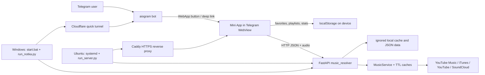

# Notka Project Index

Static architecture and navigation map for the repository. The `codebase-memory-mcp` graph tools described in the project instructions were not available in this session, so this index was assembled from the checked-out source, configuration, docs, tests, and file/symbol inventories. It is a project guide, not a line-by-line code review or a runtime verification.

## Product in One Paragraph

Notka is a Russian-language Telegram Mini App for music search and playback. The Telegram bot opens the Mini App and handles share/promo deep links. The browser app keeps a listener's library and listening history in that device's `localStorage`; FastAPI searches/resolves tracks through music providers, caches audio on disk, and serves the Mini App. Plus/event account state is stored server-side as JSON and identifies Telegram users from signed Mini App `initData`.

## Runtime Architecture

### Launch paths

- **Local Windows:** [start.bat](start.bat) creates/activates `venv`, installs `requirements.txt`, and runs [run_notka.py](run_notka.py). That launcher starts the FastAPI app on `127.0.0.1:$PORT`, mounts `miniapp/` at `/app/`, creates a temporary Cloudflare URL, then starts `bot.main` with the resulting `MINIAPP_URL`. The quick-tunnel URL changes each run.
- **Server:** [deploy/setup.sh](deploy/setup.sh) provisions Ubuntu, the `notka` user, systemd, and Caddy. [run_server.py](run_server.py) serves the API and Mini App locally and supervises/restarts the bot process. Caddy provides the public HTTPS URL from `PUBLIC_URL`. [deploy/push.sh](deploy/push.sh) ships `git archive HEAD`, installs dependencies, restarts the service, and checks `/health`.
- Both launchers call `music_resolver.main.create_app()` and mount the same static Mini App at `/app/`; API routes are at the origin root (there is no `/api` prefix).

## Top-Level Map

| Path | Responsibility |
| --- | --- |
| `bot/` | Telegram entry point, WebApp buttons, `/start` share/promo routing, owner `/promo` and `/id` commands. |
| `music_resolver/` | FastAPI API, provider adapters, search/playback services, account/event JSON stores, and audio helpers. |
| `miniapp/` | Static Telegram WebView: HTML screens, single large UI controller, CSS, theme/event canvases, and Onest fonts. |
| `tests/` | Local backend harness, Chrome DevTools driver, browser scenarios, and one direct Python event-store check. |
| `deploy/` | Ubuntu/Caddy/systemd setup and archive-based deployment scripts. |
| `рефернсы/` | 29 JPG and 2 PNG visual reference images; not runtime assets. |
| `.impeccable/` | Design-tool surface notes, tokens/config, critique, and pre-redesign source backups; not loaded by the app. |
| `PRODUCT.md`, `DESIGN.md` | Product scope/constraints and the visual design system. |
| `ЗАПУСК.txt`, `deploy/README.md` | Local and server operator instructions. |

## Backend

### Composition and shared contracts

- [music_resolver/main.py](music_resolver/main.py) builds the FastAPI app, settings, providers/services, and exception handlers.
- [music_resolver/api/routes.py](music_resolver/api/routes.py#L188) creates all routes and owns audio download/cache serving. Startup also launches a background pass that defragments old cached audio.
- [music_resolver/models.py](music_resolver/models.py) defines Pydantic wire shapes: `TrackCandidate`, `TrackInfo`, `PlaybackInfo`, `ResolvedTrack`, `SearchResponse`, `AlbumInfo`, and `ArtistInfo`. Public IDs are `source:source_id`; JSON aliases use camelCase for fields such as `sourceId` and `artistId`.
- [music_resolver/errors.py](music_resolver/errors.py) maps typed application errors to stable JSON error codes and HTTP statuses.
- [music_resolver/config.py](music_resolver/config.py) reads provider order, limits/timeouts, cache durations, stream mode, cookies, proxies, and catalog location from environment variables. Invalid proxy settings are probed once at process start and disabled if unusable.
- [music_resolver/services/factory.py](music_resolver/services/factory.py) wires providers; `youtube_music` is the first default search provider, followed by SoundCloud and plain YouTube. iTunes is also registered as a catalog/search fallback. iTunes resolves playback through a matched YouTube video.
- [music_resolver/services/music_service.py](music_resolver/services/music_service.py) validates and caches search, resolve, album, and artist calls. Resolve-cache life is shortened to stay ahead of expiring playback URLs.
- [music_resolver/services/provider_manager.py](music_resolver/services/provider_manager.py) applies per-provider timeouts, fallback ordering, candidate ranking, URL/source dispatch, and provider result logging.

### HTTP API

Definitions are in [routes.py](music_resolver/api/routes.py). `/health` is the deployment health probe.

| Method and path | Purpose |
| --- | --- |
| `GET /search`, `GET /artists` | Track search and supplementary artist-name/photo search. Artist lookup failure is non-fatal to track search. |
| `GET /resolve`, `GET /album`, `GET /artist` | Resolve a source ID/URL or fetch catalog metadata. |
| `GET /prepare`, `GET /stream`, `GET /download` | Pre-download/cache audio, stream it with byte-range support, or return a named attachment. Default stream mode is local proxy/cache; optional modes are redirect and JSON. |
| `GET /radio`, `POST /mood` | YouTube Music radio for “Мой микс” and a mood-based candidate mix. |
| `GET /lyrics` | Timed/plain lyrics from LRCLIB, with YouTube Music as an additional source when applicable. |
| `GET /import` | Read a public Spotify, Yandex Music, Apple Music, YouTube, or YouTube Music playlist/album for import. |
| `GET /plus/status`, `POST /plus/redeem` | Check/redeem Plus using `X-Telegram-Init-Data`; redeem attempts are rate-limited per user in process memory. |
| `GET /events`, `POST /events/sync`, `/events/advance`, `/events/reset` | Event catalog/progress/rewards. User operations use signed Telegram init data; advance/reset are preview-only operations. |
| `GET /bot-info` | Lazily fetch and cache the Telegram bot username for share links. |
| `POST /shared`, `GET /shared/{share_id}` | Store/fetch a small JSON playlist snapshot for share links. |

### Provider and service modules

| Path | Role |
| --- | --- |
| `providers/base.py` | Structural `MusicProvider` protocol. |
| `providers/youtube_music.py` | Main catalog: songs, artists, albums, YouTube Music radio, mood playlists, and catalog mapping. |
| `providers/youtube_common.py` | Shared yt-dlp URL parsing, metadata/audio selection, expiry/MIME handling, optional cookies/proxy, and correct fragmented-stream downloads. |
| `providers/youtube_web.py` | Plain YouTube search and playback fallback, implemented with yt-dlp. |
| `providers/itunes_catalog.py` | Keyless iTunes metadata/search, artist/album catalog, strict title/artist/duration checks when matching playable YouTube audio. |
| `providers/soundcloud.py` | SoundCloud search and direct audio resolution through yt-dlp. |
| `services/matcher.py` | Text normalization, candidate scoring, and ranking. |
| `services/playlist_import.py` | Public playlist readers and normalized `{title, artist, duration}` items. YouTube items can also carry a ready-to-play track. |
| `services/lyrics.py` | LRC parsing, plain text cleanup, cache, and source lookup. |
| `services/mood_mix.py`, `services/energy.py` | Mood mix built from listener seeds, known artists, radio, and available cached-track energy measurements. |
| `services/plus_store.py` | `data/plus.json` user entitlements and promo codes; verifies Telegram `initData` HMAC and auth age. Shared by API and bot. |
| `services/events_store.py` | `events.json`, event dates/tasks/progress/reward grants, and preview-time controls. |
| `utils/remux.py` | Uses bundled `imageio-ffmpeg` to repair fragmented M4A files. |
| `utils/ids.py`, `utils/logging.py` | Public ID parsing and provider log formatting. |

### Persistence and external boundaries

- Favorites, playlists, follows, profile overrides, listening stats, and recent tracks are device-local; there is no account library sync in the current design. Browser key: `notka_state_v2` in `miniapp/app.js`.
- Plus and event data are server-side JSON under `data/`, configurable with `NOTKA_DATA_DIR`; the local test harness separates event state with `NOTKA_EVENTS_DIR`.
- Audio files and shared-playlist JSON live under ignored `cache/`; the audio cache defaults to 2 GB and is trimmed by least-recent use. iTunes also has a disk metadata cache there.
- External catalog/playback boundaries are YouTube Music (`ytmusicapi`), YouTube and SoundCloud (`yt-dlp`), Apple iTunes Search, LRCLIB, Telegram Bot API, and the public playlist pages/APIs listed above.

## Telegram Bot

- [bot/main.py](bot/main.py) registers aiogram polling and sets the persistent chat menu WebApp button.
- `/start` opens the app normally, routes `t_...` / `p_...` share payloads back to a track/playlist, and converts `promo_...` into an app URL that redeems a code.
- `/id` reports the caller's Telegram ID. `/promo` is restricted to `ADMIN_IDS` and lists, creates, or disables codes in the same JSON store used by the backend.
- [bot/config.py](bot/config.py) requires `BOT_TOKEN` and an HTTPS `MINIAPP_URL`.

## Mini App

### HTML screens

[miniapp/index.html](miniapp/index.html) defines 21 screen roots: splash, onboarding, home, event, search, library, favorites, playlist, album, artist, add tracks, edit playlist, profile, account, stats, sound, about, mood, look, Plus, and full player. The bottom tabs are Home/Search/Library; other pages use the shared navigation stack and Telegram BackButton.

The HTML loads `config.js`, `prism.js`, `shredder.js`, `atmosphere.js`, `pumpkin.js`, then `app.js`. Styles are split between core `styles.css`, seasonal `atmosphere.css`, and `events.css`. Version query parameters are cache-busters for Telegram WebView's static-file cache; bump them when their assets change.

### Main controller and visual modules

- [miniapp/app.js](miniapp/app.js) is the main controller (4.8k lines). Useful regions: Telegram/viewport and local state (1–274); palettes/light and navigation (331–818); track rows and playlist import (819–1171); Home/recent/time machine/fresh releases/mixes (1172–1702); search and library/playlists/share (1703–2323); profile/Plus/appearance/events/stats (2324–3606); queue/player/lyrics/download (3607–4238); artist and album pages (4239–4540); playback statistics and launch/deep links (4541–4794).
- The controller wraps Telegram WebApp (ready/fullscreen, safe areas, haptics, BackButton), mirrors Telegram's keyboard-aware viewport into `--tg-vh`, and uses localStorage for user library state.
- Search requests `/search` and `/artists` concurrently. Playlist import searches each imported title/artist/duration against Notka's catalog. Shared track and playlist links go through the bot's `start` payload.
- Playback calls `/prepare` before setting the audio element to `/stream`, prepares the next queue item, and coordinates queue, Media Session, sleep timer, lyrics, listening stats, and track-derived light palette.
- `prism.js` exports `window.Prism` for the light-beam effect; `shredder.js` exports `window.Shredder` for the track/list interaction; `atmosphere.js` exports `window.Atmosphere` for seasonal canvas themes; `pumpkin.js` exports `window.PumpkinArt` for event art/reward effects.
- `styles.css` is the base layout/component/player styling. `atmosphere.css` decorates theme states; `events.css` styles event screens, progress, pumpkin, and reward states. Four self-hosted Onest WOFF2 files are in `miniapp/fonts/`.
- [DESIGN.md](DESIGN.md) records design tokens, type, layout, motion, and component rules. [PRODUCT.md](PRODUCT.md) records shipped features, constraints, and product decisions. `.impeccable/` contains design tooling state/notes and old source backups, not the current runtime source.

## Tests and Local QA

Tests were inventoried but not run as part of this indexing request.

| File(s) | Scope / role |
| --- | --- |
| `tests/serve_local.py` | Local API + Mini App on port 8099; supplies a synthetic Telegram test user and preview date. |
| `tests/cdp.mjs` | Headless Chrome DevTools helper: navigate, evaluate, click, screenshot, collect console/network errors. Assumes Chrome at `C:/Program Files/Google/Chrome/Application/chrome.exe`. |
| `tests/e2e.mjs`, `home.mjs`, `search_artists.mjs` | Core launch/player and home/search/artist result flows. |
| `tests/import.mjs`, `lyrics.mjs`, `mood.mjs` | Playlist import, lyrics, and mood mix flows. |
| `tests/plus.mjs`, `promo.mjs`, `events.mjs`, `events_store_test.py` | Plus preview/redeem, promo links/codes, event UI/store and reward rules. |
| `tests/stats.mjs`, `timemachine.mjs` | Listening stats and day/history views. |
| `tests/themes.mjs`, `look.mjs`, `atmosphere.mjs`, `atmosphere_player.mjs` | Player themes, appearance controls, and seasonal effects. |
| `tests/silence_scan.mjs` | Audio-cache silence scan. |

There is no root Node package manifest or Python project/test configuration; Python dependencies are declared in `requirements.txt`, and the browser checks are standalone `.mjs` files.

## Configuration Pointers

- **Required runtime:** `BOT_TOKEN`; `MINIAPP_URL` is supplied by the local launcher or derived from `PUBLIC_URL` by the server launcher. `PORT` defaults to 8080; production `RUN_BOT=0` permits backend-only mode.
- **Provider behavior:** `PROVIDER_ORDER`, `DISABLED_PROVIDERS`, `PROVIDER_TIMEOUT`, `SEARCH_LIMIT`, `CACHE_TTL`, `RESOLVE_CACHE_TTL`, `STREAM_RESPONSE_MODE` (`proxy`, `redirect`, `json`).
- **YouTube/catalog networking:** `YTDLP_COOKIE_FILE`, `YTDLP_COOKIES_FROM_BROWSER`, `YTDLP_PROXY`, `YTDLP_FORCE_IPV6`, `ITUNES_PROXY`, `YTMUSIC_PROXY`, `YTMUSIC_LOCATION`.
- **Storage/owner:** `AUDIO_CACHE_MAX_MB`, `NOTKA_DATA_DIR`, `ADMIN_IDS`. `NOTKA_FAKE_NOW`, `NOTKA_EVENTS_DIR`, and `NOTKA_TEST_USER` support the local event harness/preview.
- **Static Mini App settings:** `miniapp/config.js` controls `API_BASE_URL` (empty means same origin) and `PLUS_PREVIEW`.

## Findings and Limits

1. **Potential startup blocker:** `music_resolver/services/music_service.py` imports `TTLCache` from `music_resolver.cache.ttl`, but there is no `music_resolver/cache/` directory or tracked module in this checkout. The broad `.gitignore` rule `cache/` also ignores directories of that name. Static source inspection suggests the backend may fail at import time unless the missing module is supplied externally; the app was not launched to confirm.
2. **Config documentation drift:** `bot/config.py` mentions `.env.example`, but no `.env.example` is present in the listed checkout. `start.bat` instead copies a local `env_setup.txt` if present; that file is ignored.
3. Graph-based semantic indexing could not be performed because no codebase-memory graph MCP server/tools were exposed. This document is the available manual project index.
