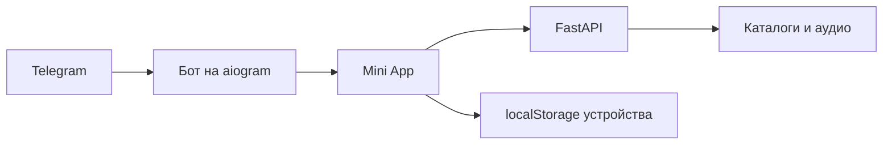

<div align="center">

# 🎧 Нотка

### Музыка прямо в Telegram

Найди трек, нажми ▶ и продолжай слушать — не выходя из чата.

**Поиск · Плеер · Любимое · Свои плейлисты · Мой микс**

[Быстрый запуск](#быстрый-запуск-windows) · [Возможности](#что-умеет-нотка) · [Архитектура](PROJECT_INDEX.md) · [Деплой](deploy/README.md)

</div>

---

## Что умеет Нотка

| 🎼 Слушать | ✨ Собрать своё |
| --- | --- |
| Искать треки, исполнителей и альбомы | Отмечать любимое и создавать плейлисты |
| Включать очередь, перемешивать и повторять | Получать персональный «Мой микс» и подборки под настроение |
| Читать текст песни и делиться ссылками | Импортировать открытые плейлисты из популярных сервисов |
| Скачивать треки и ставить таймер сна | Смотреть историю и статистику прослушивания |

Интерфейс сделан для Telegram WebView: учитывает его высоту, безопасные области, жесты и системную кнопку «Назад».

## Быстрый запуск (Windows)

1. Создай в корне проекта файл `.env` и добавь токен бота от [@BotFather](https://t.me/BotFather):

   ```env
   BOT_TOKEN=вставь_токен_сюда
   ```

2. Запусти `start.bat`. При первом запуске он создаст виртуальное окружение и установит зависимости.
3. Дождись ссылки на мини-апп в окне запуска, затем открой бота в Telegram и отправь `/start`.
4. Нажми **«Открыть Нотку»**.

Пока окно запуска открыто, работают бот и мини-апп. Закрытие окна останавливает их. Бесплатная ссылка Cloudflare меняется при следующем запуске.

> Храни `.env` локально: токен бота нельзя публиковать или добавлять в Git.

## Как устроен проект



- **Mini App** — HTML/CSS/JavaScript внутри Telegram; интерфейс находится в `miniapp/`.
- **Backend** — FastAPI-сервис `music_resolver/`: поиск, метаданные, подготовка и выдача аудио.
- **Бот** — `bot/`: открывает приложение и обрабатывает ссылки на треки, плейлисты и промокоды.
- **Локальные данные** — любимое, плейлисты и статистика хранятся в браузере этого устройства; синхронизации библиотеки между устройствами пока нет.

Для карты модулей, API, конфигурации и QA-сценариев смотри [PROJECT_INDEX.md](PROJECT_INDEX.md). Продуктовые решения и визуальные правила описаны в [PRODUCT.md](PRODUCT.md) и [DESIGN.md](DESIGN.md).

## Разработка и деплой

- Python-зависимости: `requirements.txt`.
- Локальная проверочная среда: `tests/serve_local.py`; браузерные сценарии и их драйвер лежат в `tests/`.
- Постоянный сервер Ubuntu с HTTPS через Caddy: [deploy/README.md](deploy/README.md).
- При изменении `miniapp/app.js` или стилей обновляй их `?v=` в `miniapp/index.html`, чтобы Telegram загрузил свежие файлы.

<details>
<summary>Статическая находка в текущем checkout</summary>

`music_resolver/services/music_service.py` импортирует `music_resolver.cache.ttl`, но такого модуля в checkout нет. Правило `cache/` в `.gitignore` также скрывает каталоги с таким именем. Это может мешать запуску backend; исходники были изучены статически, запуск здесь не проверялся.

</details>
