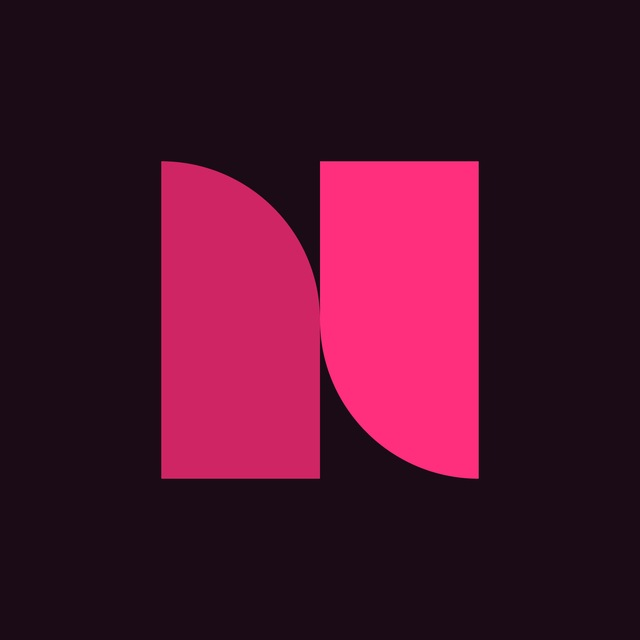

# Notka Client Apps (Android & Desktop)

Официальный репозиторий клиентских приложений для музыкального сервиса **Нотка** ([Notka](https://notka.duckdns.org)).

<p align="center">
  
</p>

## Архитектура: Dynamic Hybrid Shell

Главная проблема традиционных гибридных приложений — необходимость пересобирать бинарники (APK / инсталляторы) при каждом изменении интерфейса. 

Приложения **Нотка** построены по принципу **Dynamic Hybrid Shell**:
1. **Легковесный нативный контейнер**: Нативное приложение Android (Android WebView) и Windows Desktop (WebView2) занимает считанные килобайты/мегабайты памяти (Android APK всего ~40 КБ, запуск занимает меньше 0.5 с).
2. **Мгновенные обновления веб-интерфейса**: Приложение загружает актуальный веб-интерфейс напрямую с прода (`https://notka.duckdns.org/app/`). Любые изменения стилей, плеера, экранов и логики сразу же доступны пользователям без переустановки APK!
3. **Глубокая нативная интеграция**:
   - `MediaSession` и нативный `MediaPlaybackService` — полноценная шторка управления плеером (Play / Pause / Next / Prev), системные медиаклавиши, виджет на экране блокировки и передача обложек треков.
   - Нативные виброотклики (Haptic Feedback) под разные действия (легкий, средний, жесткий, уведомления).
   - Safe-area insets (`--tg-safe-area-inset-top`, `--tg-safe-area-inset-bottom`) для идеального отображения на экранах с вырезами и "челками".
   - Грамотная обработка жестов и кнопки «Назад»: закрытие открытых штор и модальных окон, а при закрытии главного экрана — сворачивание в фон без остановки музыки (`moveTaskToBack`).
4. **Стильный офлайн-режим (`offline.html`)**: При отсутствии интернет-соединения приложение показывает экран в стиле Dark Living Light с кнопкой повтора и авто-восстановлением при появлении сети.
5. **Никакого Electron на ПК**: Компьютерный клиент использует нативный Windows WebView2 (Chromium-движок Edge, встроенный в Windows 10/11), что снижает потребление RAM с 400 МБ до 30–50 МБ.

---

## Структура репозитория

```
notka-app/
├── android/                   # Мобильное приложение для Android
│   ├── app/src/main/
│   │   ├── java/space/notka/app/
│   │   │   ├── MainActivity.java           # Конфигурация WebView, навигация, insets
│   │   │   ├── MediaPlaybackService.java   # Фоновая служба, MediaSession, шторка
│   │   │   └── WebAppInterface.java        # Мост JavaScript <-> Android, вибро, URL
│   │   ├── assets/
│   │   │   └── offline.html                # Локальный экран отсутствия сети
│   │   └── res/                            # Ресурсы, иконки, цвета, стили
│   ├── tools/                              # Автономные утилиты сборки (aapt2, ecj, r8, signer)
│   ├── build.ps1                           # Скрипт мгновенной сборки и установки через ADB
│   ├── build.gradle.kts                    # Стандартная поддержка Gradle / Android Studio
│   └── settings.gradle.kts
├── desktop/                   # Компьютерное приложение (Windows Desktop)
└── README.md
```

---

## Сборка Android приложения

### Быстрая сборка через PowerShell (без Gradle, занимает ~5 секунд)

Скрипт `build.ps1` автономно компилирует ресурсы через `aapt2`, компилирует Java через `ecj`, переводит в DEX через `r8/d8` и подписывает APK через `uber-apk-signer`:

```powershell
# Только собрать APK:
powershell -NoProfile -ExecutionPolicy Bypass -File android/build.ps1

# Собрать и автоматически установить на подключенный через ADB телефон:
powershell -NoProfile -ExecutionPolicy Bypass -File android/build.ps1 -Install
```

Готовый файл APK сохраняется в `android/build/dist/notka.apk`.

### Сборка через Gradle / Android Studio

Откройте папку `android/` в Android Studio или выполните:

```bash
./gradlew assembleDebug
```

---

## Безопасность и Open Source

В репозитории строго соблюдается изоляция секретов:
- Никаких захардкоженных токенов, ключей доступа или внутренних приватных IP-адресов.
- Все внешние адреса обращаются к публичным каноническим доменам либо настраиваются динамически.

## Лицензия

GPL v3. См. файл [LICENSE](LICENSE).
