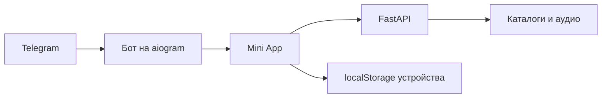

<div align="center">

# 🎧 Нотка

### Музыка прямо в Telegram

Найди трек, нажми ▶ и продолжай слушать — не выходя из чата.

**Поиск · Плеер · Любимое · Свои плейлисты · Мой микс**

[Документация (docs/)](docs/README.md) · [Быстрый запуск](#быстрый-запуск-windows) · [Возможности](#что-умеет-нотка) · [Архитектура](PROJECT_INDEX.md) · [Дизайн](DESIGN.md) · [Продукт](PRODUCT.md) · [Деплой](deploy/README.md)

</div>

---

## Что умеет Нотка

| 🎼 Слушать | ✨ Собрать своё |
| --- | --- |
| Искать треки, исполнителей и альбомы | Отмечать любимое и создавать плейлисты |
| Включать очередь, перемешивать и повторять | Получать персональный «Мой микс» и подборки под настроение |
| Читать текст песни и делиться ссылками | Импортировать открытые плейлисты из популярных сервисов |
| Скачивать треки и ставить таймер сна | Смотреть историю и статистику прослушивания |

Интерфейс сделан для Telegram WebView: учитывает его высоту, безопасные области, жесты и системную кнопку «Назад».

## Кто делает Нотку

Над проектом работают два разработчика: **leksik** и **hackov (Егор, [crxwov](https://github.com/crxwov))**. leksik создал первоначальную Нотку, её дизайн и функциональность. hackov подключился позже и активно помогает с приложениями, инфраструктурой, развитием и исправлениями. Теперь проект развивается совместно.

`tg-app` — Telegram Mini App, бот и связанные изменения; `app-dev` — клиентские приложения; `main` — общая стабильная версия для релиза. Разработчики помогают друг другу и согласуют изменения общих компонентов. Для людей и ИИ-агентов действуют [правила совместной работы](docs/operations/collaboration.md) и [AGENTS.MD](AGENTS.MD).

Перед работой читать свежие [todo.md](todo.md), [already-work-leksik.md](already-work-leksik.md) и [already-work-crxwov.md](already-work-crxwov.md). todo содержит незавершённые планы; already-work — подробное текущее состояние и занятые области. Агенты публикуют свой статус до правок, примерно раз в минуту во время работы и при завершении, предупреждают пользователя о пересечениях. Локальные Roadmap и файлы памяти разрешены, но не коммитятся и не публикуются; детали и команда heartbeat — в [правилах сотрудничества](docs/operations/collaboration.md).

Проверенное устройство серверов, музыки, данных и резервных копий описано в [отчёте об инфраструктуре от 14.10.2026](docs/operations/infrastructure-2026-10-14.md). Датированный отчёт содержит подтверждённые факты и явно отмеченные пробелы проверки.

## Быстрый запуск (Windows)

1. Создай в корне проекта файл `.env` и добавь токен бота от [@BotFather](https://t.me/BotFather):

   ```env
   BOT_TOKEN=вставь_токен_сюда
   ```

2. Запусти `start.bat`. При первом запуске он создаст виртуальное окружение и установит зависимости.
3. Дождись ссылки на мини-апп в окне запуска, затем открой бота в Telegram и отправь `/start`.
4. Нажми **«Открыть Нотку»**.

Пока окно запуска открыто, работают бот и мини-апп. Закрытие окна останавливает их. Бесплатная ссылка Cloudflare меняется при следующем запуске.

> Храни `.env` локально: токен бота нельзя публиковать или добавлять в Git.

## Как устроен проект



- **Mini App (`miniapp/`)** — действующий веб-интерфейс: `index.html`, монолитный `app.js`, `styles.css` / `system.css`, отдельные скрипты эффектов и `mix.js`.
- **Backend (`music_resolver/`)** — FastAPI: маршруты в `api/routes.py`, музыкальные провайдеры в `providers/`, логика сопоставления, кэширования, синхронизации и сессий в `services/`.
- **Бот (`bot/`)** — `aiogram 3.x`, long polling: запуск приложения, диплинки, inline-аудио, промокоды и коды входа.
- **Android (`android/`)** — Java/WebView с нативным управлением воспроизведением и собственной модульной копией frontend в assets. Обновление веб-сайта не обновляет HTML/JS внутри установленного APK.
- **Хранение** — локальные JSON пользовательских данных и файловый аудиокэш; общий backend используется обоими клиентами.

Для полной карты модулей, API, конфигурации и QA-сценариев смотри [PROJECT_INDEX.md](PROJECT_INDEX.md) и [docs/getting-started/project-structure.md](docs/getting-started/project-structure.md). Продуктовые решения и визуальные правила описаны в [PRODUCT.md](PRODUCT.md) и [DESIGN.md](DESIGN.md).

## Разработка и тестирование

- Python-зависимости: `requirements.txt`.
- Запуск тестов:
  ```bash
  venv\Scripts\python -m pytest tests/
  ```
  Конкретные доступные проверки перечислены в [индексе проекта](PROJECT_INDEX.md); наличие полной проверки каждого API и провайдера не предполагается автоматически.
- Локальная проверочная среда: `tests/serve_local.py`; сквозные E2E-тесты в headless Chromium: `tests/e2e.mjs`.
- Сервер Ubuntu; публичный nginx → Caddy → FastAPI; исходящий sing-box/Hysteria: [инфраструктура](docs/operations/infrastructure-2026-10-14.md), [деплой](deploy/README.md).
- При изменении модулей `miniapp/` или стилей обновляй их версии `?v=` в `miniapp/index.html`.

