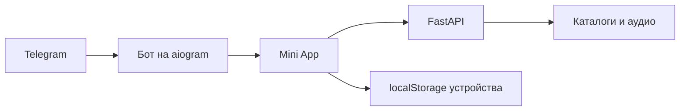

<div align="center">

# 🎧 Нотка

### Музыка прямо в Telegram

Найди трек, нажми ▶ и продолжай слушать — не выходя из чата.

**Поиск · Плеер · Любимое · Свои плейлисты · Мой микс**

[Документация (docs/)](docs/README.md) · [Быстрый запуск](#быстрый-запуск-windows) · [Возможности](#что-умеет-нотка) · [Архитектура](PROJECT_INDEX.md) · [Дизайн](DESIGN.md) · [Продукт](PRODUCT.md) · [Деплой](deploy/README.md)

</div>

---

## Что умеет Нотка

| 🎼 Слушать | ✨ Собрать своё |
| --- | --- |
| Искать треки, исполнителей и альбомы | Отмечать любимое и создавать плейлисты |
| Включать очередь, перемешивать и повторять | Получать персональный «Мой микс» и подборки под настроение |
| Читать текст песни и делиться ссылками | Импортировать открытые плейлисты из популярных сервисов |
| Скачивать треки и ставить таймер сна | Смотреть историю и статистику прослушивания |

Интерфейс сделан для Telegram WebView: учитывает его высоту, безопасные области, жесты и системную кнопку «Назад».

## Быстрый запуск (Windows)

1. Создай в корне проекта файл `.env` и добавь токен бота от [@BotFather](https://t.me/BotFather):

   ```env
   BOT_TOKEN=вставь_токен_сюда
   ```

2. Запусти `start.bat`. При первом запуске он создаст виртуальное окружение и установит зависимости.
3. Дождись ссылки на мини-апп в окне запуска, затем открой бота в Telegram и отправь `/start`.
4. Нажми **«Открыть Нотку»**.

Пока окно запуска открыто, работают бот и мини-апп. Закрытие окна останавливает их. Бесплатная ссылка Cloudflare меняется при следующем запуске.

> Храни `.env` локально: токен бота нельзя публиковать или добавлять в Git.

## Как устроен проект



- **Mini App (`miniapp/`)** — модульный веб-интерфейс внутри Telegram:
  - `src/core/` — окружение, глобальное состояние, синхронизация, аналитика и DOM-утилиты.
  - `src/player/` — аудиодвижок, светомузыка, синхронные тексты (LRC), очередь и громкость.
  - `src/ui/` — навигация, модальные окна, шторки, строки треков и контекстные меню.
  - `src/screens/` — изолированные экраны (главная, поиск, плейлисты, профиль, настройки, ивенты, рекап, артисты).
  - `styles/` — декомпозированные таблицы стилей (компоненты, контролы, экраны, плеер, анимации).
  - `atmosphere/` и `shredder/` — модули визуальных эффектов и интерактивного шредера.
- **Backend (`music_resolver/`)** — модульный FastAPI-сервис:
  - `api/routes/` — логически разделенные эндпоинты (аудио, кэш, поиск, авторизация, Плюс, ивенты, медиа, админка).
  - `providers/itunes/` и `providers/youtube/` — декомпозированные клиенты каталогов и стриминга.
  - `services/` — логика сопоставления, кэширования, текстов песен и сессий.
- **Бот (`bot/`)** — `aiogram 3.x`: запуск приложения, обработка диплинков и промокодов.
- **Архитектурный стандарт**: строгий лимит размера файлов — **до 450–500 строк на файл** с четким разделением ответственности.

Для полной карты модулей, API, конфигурации и QA-сценариев смотри [PROJECT_INDEX.md](PROJECT_INDEX.md) и [docs/getting-started/project-structure.md](docs/getting-started/project-structure.md). Продуктовые решения и визуальные правила описаны в [PRODUCT.md](PRODUCT.md) и [DESIGN.md](DESIGN.md).

## Разработка и тестирование

- Python-зависимости: `requirements.txt`.
- Запуск тестов:
  ```bash
  venv\Scripts\python -m pytest tests/
  ```
  В репозитории настроен полный набор модульных и интеграционных тестов для API, провайдеров, моделей и сервисов.
- Локальная проверочная среда: `tests/serve_local.py`; сквозные E2E-тесты в headless Chromium: `tests/e2e.mjs`.
- Постоянный сервер Ubuntu с HTTPS через Caddy: [deploy/README.md](deploy/README.md).
- При изменении модулей `miniapp/` или стилей обновляй их версии `?v=` в `miniapp/index.html`.

