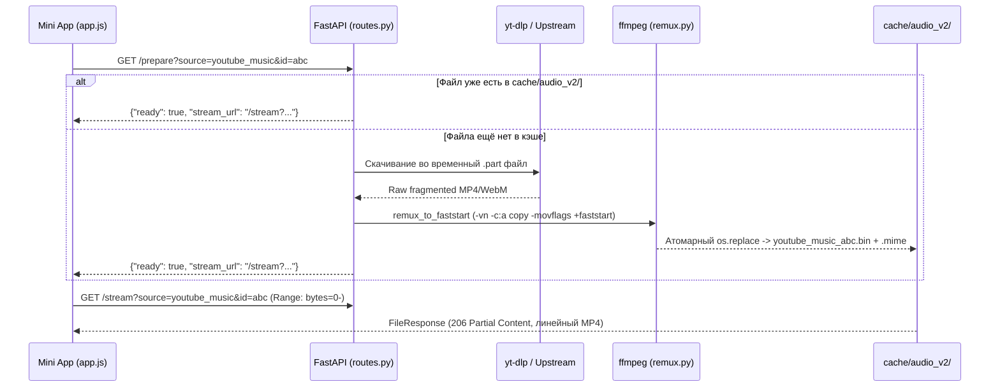

# Пайплайн аудио-стриминга и дискового кэша

[← Справочник HTTP API](http-api.md) · [К оглавлению](../README.md) · [Далее: Провайдеры и скоринг →](../providers/overview-and-scoring.md)

---

## Проблема: обрыв звука в Telegram WebView через 10 секунд

YouTube отдаёт аудиодорожки (особенно `m4a` `itag=140`) в виде **фрагментированного MP4 (DASH)**, разбитого на короткие пары атомов `moof` + `mdat`.

Встроенный браузер Telegram WebView на Android и iOS при потоковом воспроизведении такого файла напрямую:
1. Часто перестаёт воспроизводить звук ровно на 10-й секунде (после окончания первого фрагмента `moof`).
2. Некорректно определяет общую длительность (`audio.duration` равен `Infinity`, `NaN` или `10.0`), из-за чего ломается перемотка.

---

## Решение: двухфазный пайплайн `/prepare` $\rightarrow$ `/stream`

В `music_resolver/api/routes.py` и `music_resolver/utils/remux.py` реализован надёжный серверный пайплайн подготовки аудио:



### 1. Скачивание и блокировка дублей (`_ensure_cached`)
В `music_resolver/api/routes.py`:
- Для каждого ключа `{source}_{id}` создаётся индивидуальный `asyncio.Lock` в словаре `_download_locks`. Если клиент одновременно вызвал `/prepare` и `/stream`, скачивание выполнится ровно один раз.
- Для `youtube_music` и `youtube` сначала используется быстрый прямой метод `YoutubeCommon.download_to_file()`, который скачивает поток средствами `yt-dlp` в пуле из 6 потоков (`_DL_EXECUTOR`).
- Если прямой метод не сработал (или источник — `soundcloud`), вызывается `service.resolve()` и поток скачивается через `httpx.AsyncClient` чанками по 64 КБ.

### 2. Дефрагментация MP4 (`music_resolver/utils/remux.py`)
Функция `remux_to_faststart(path)`:
- Ищет бинарник `ffmpeg` (сначала из пакета `imageio-ffmpeg`, затем системный `ffmpeg` в `PATH`).
- Считывает первые 12 байт скачанного файла. Если на байтах `[4:8]` обнаружена сигнатура MP4 `ftyp`, запускает:
  ```bash
  ffmpeg -nostdin -hide_banner -loglevel error -y -i <input> -vn -c:a copy -movflags +faststart <output.mp4>
  ```
- Команда работает **без перекодирования звука** (`-c:a copy`, занимает $\sim 50\text{–}150\text{ мс}$), склеивает все DASH-фрагменты в единый непрерывный контейнер и переносит таблицу индексов `moov` в самое начало файла.

### 3. Отдача с поддержкой перемотки (`GET /stream`)
- Как только файл готов в `cache/audio_v2/{key}.bin`, эндпоинт `/stream` отдаёт его через `starlette.responses.FileResponse`.
- `FileResponse` из коробки поддерживает заголовки `Accept-Ranges: bytes`, `Content-Length` и ответы `206 Partial Content`, поэтому перемотка в плеере работает мгновенно в любую точку трека.

### 4. Автоматическая LRU-очистка кэша (`_maybe_prune_cache`)
- После каждой новой загрузки запускается фоновая задача `_maybe_prune_cache()`.
- Если суммарный размер `*.bin` файлов в `cache/audio_v2/` превышает `AUDIO_CACHE_MAX_MB` (по умолчанию `2048 МБ`), файлы сортируются по времени последнего обращения (`st_mtime`) и самые старые удаляются, пока кэш не уменьшится до 85% от лимита.
- При чтении файла из кэша его `mtime` обновляется (`os.utime`), сохраняя популярные треки на диске.
