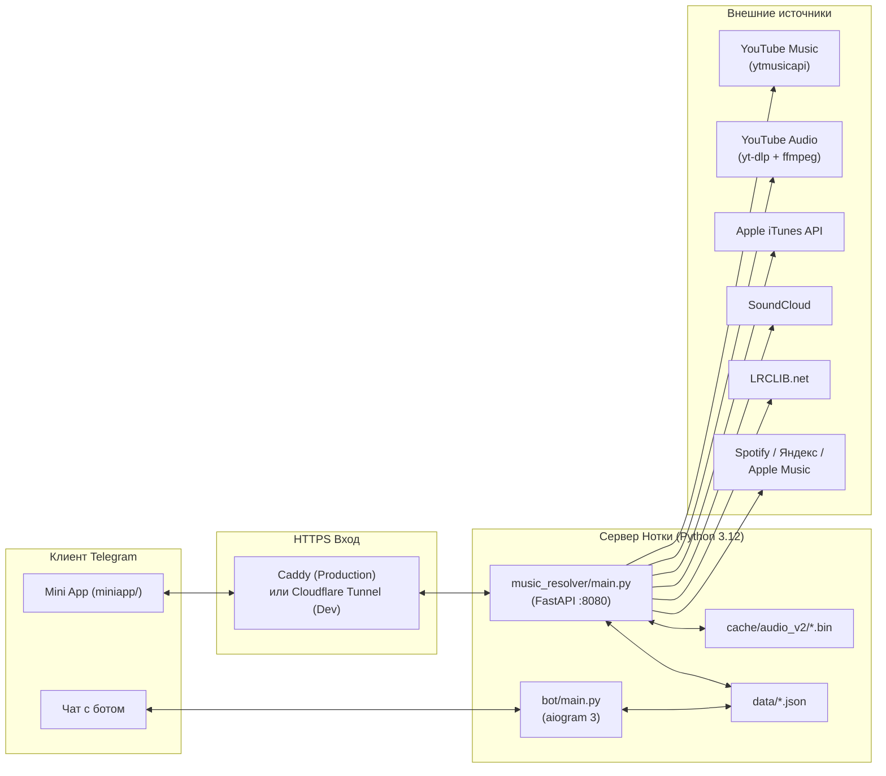

# Обзор архитектуры и режимов запуска

[← К оглавлению документации](../README.md) · [Далее: Конфигурация и `.env` →](configuration.md)

---

Нотку совместно разрабатывают **leksik** (первоначальный проект) и **hackov / Егор / crxwov** (подключился позже). Перед работой — [правила сотрудничества](../operations/collaboration.md). Действующая структура исходников — [карта проекта](project-structure.md), серверные факты — [инфраструктура 14.10.2026](../operations/infrastructure-2026-10-14.md). Веб-клиент и встроенный Android frontend различаются; текущая внешняя цепочка включает nginx перед Caddy.

## Архитектура системы

**«Нотка» (`Notka`)** объединяет три компонента, которые работают согласованно на одном сервере (или локальном ПК):

1. **Telegram-бот (`bot/`)** на `aiogram 3` — точка входа пользователя в мессенджере, обработчик deep-link ссылок на треки/плейлисты/промокоды и админ-панель управления подпиской **Нотка Плюс**.
2. **Бэкенд-резолвер (`music_resolver/`)** на `FastAPI` — ищет треки параллельно в нескольких источниках, извлекает аудиопотоки через `yt-dlp`, дефрагментирует MP4 через `ffmpeg`, стримит аудио с поддержкой `Range`-запросов, анализирует энергетику треков, отдаёт караоке-тексты и хранит прогресс ивентов/Плюса.
3. **Telegram Mini App (`miniapp/`)** на чистом JS + CSS + WebGL2/Canvas2D — мобильное приложение внутри WebView Telegram с 21 экраном, живым светом обложки, сменными видами плеера (винил, CD, кассета, постер) и офлайн-бэкапом коллекции.

---

## Три режима запуска

### 1. Локальный запуск на Windows (`start.bat` $\rightarrow$ `run_notka.py`)
Предназначен для разработки и быстрого запуска с домашнего компьютера:
1. Загружает `.env` и по умолчанию выставляет `YTDLP_COOKIES_FROM_BROWSER=chrome`, чтобы `yt-dlp` автоматически использовал куки локального браузера Chrome.
2. В фоновом потоке `_start_http_server()` поднимает `uvicorn` с `music_resolver.main:app` и монтирует папку `miniapp/` на маршрут `/app` (`127.0.0.1:8080`).
3. Поднимает бесплатный публичный HTTPS-туннель `*.trycloudflare.com` через `pycloudflared` (Telegram требует HTTPS для открытия Mini App).
4. Запускает `python -m bot.main` дочерним процессом, передавая ему `MINIAPP_URL=https://<tunnel>.trycloudflare.com/app/`.

### 2. Продакшен-сервер на Ubuntu (`run_server.py`)
Работает под управлением `systemd` (`notka.service`) за веб-сервером `Caddy`:
1. Вычисляет `MINIAPP_URL=${PUBLIC_URL}/app/`.
2. Монтирует `miniapp/` на `/app` и подключает middleware `_no_cache_miniapp`, который выставляет заголовок `Cache-Control: no-cache` на все файлы `/app/*` (гарантирует, что мобильный WebView Telegram сразу подхватывает обновления интерфейса).
3. В фоновом потоке `_run_bot_forever()` запускает супервайзер `python -m bot.main`:
   - Если бот упал после более чем $60\text{ с}$ стабильной работы — перезапускает через $5\text{ с}$.
   - Если упал сразу на старте — ждёт $30\text{ с}$ перед следующей попыткой.
   - Поллинг бота можно отключить переменной `RUN_BOT=0`.
4. В главном потоке запускает `uvicorn` на `127.0.0.1:8080`.

### 3. Тестовый локальный стенд (`tests/serve_local.py`)
Предназначен для прогона браузерных E2E-тестов (`tests/e2e.mjs`) и верстки:
- Поднимает FastAPI + `/app` на `127.0.0.1:8099` без Telegram-бота и без туннеля.
- Создаёт изолированную временную папку для `NOTKA_EVENTS_DIR`.
- Выставляет `NOTKA_TEST_USER=424242` и `NOTKA_FAKE_NOW=2026-10-22` (день старта Хэллоуин-ивента).
