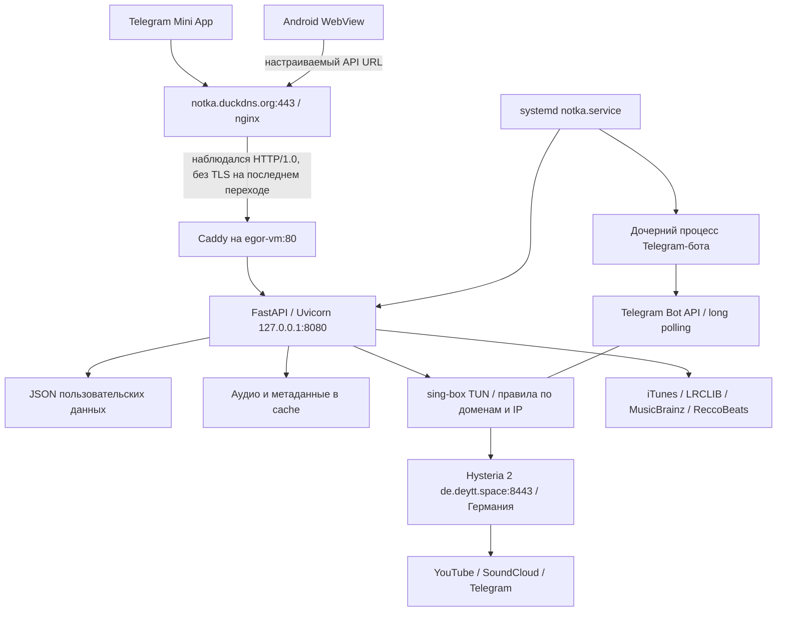

# Инфраструктура Нотки: проверенное устройство проекта

Срез: **14 октября 2026, около 15:42 по Екатеринбургу (UTC+5)**.

Исследование выполнено по исходникам и через SSH в режиме чтения. На сервере ничего не устанавливалось, не редактировалось и не перезапускалось; сообщения пользователям не отправлялись. Проверены работающие процессы, порты, конфигурация, структура хранения, архивы, журналы и публичные HTTP-ответы. Секреты и содержимое пользовательских записей в отчёт не включены.

Проект совместно разрабатывают **Lexic** (создал первоначальную Нотку, дизайн и функциональность) и **hackov / Егор / crxwov** (подключился позже и активно помогает с приложениями, инфраструктурой и развитием). Общие правила для разработчиков и их агентов — [collaboration.md](collaboration.md). `tg-app` и `app-dev` — рабочие ветки, `main` — общая стабильная версия. Этот отчёт фиксирует runtime до публикации документации; последующий push документации не означает изменение сервера.

## 1. Общая картина

Нотка — Telegram Mini App, Telegram-бот и файловый музыкальный backend. Отдельно существует Android-клиент на Java/WebView с собственной встроенной копией интерфейса.

Основное приложение живёт на Ubuntu-машине `egor-vm`, доступной по SSH через `5.227.61.107:6767`. Внутри машины адрес интерфейса — `192.168.1.134`. Она находится за внешней сетевой инфраструктурой: публичный IP не назначен её интерфейсу напрямую.

Домен `notka.duckdns.org` сейчас резолвится в **193.233.112.190**. Публичный HTTPS отвечает сервером **nginx**, а основной сервер использует **Caddy**. Контрольный запрос к публичному домену найден в локальном журнале Caddy: цепочка действительно доходит до исследованного приложения.

На рисунке связь с Bot API логическая: исходящие соединения бота также проходят сетевые правила sing-box. Схема между внешним nginx и частной машиной восстановлена по запросам и адресам; **точные правила NAT, конфигурация внешнего nginx и его владелец не проверены**.

## 2. Машины и ресурсы

| Узел | Роль | Что подтверждено |
|---|---|---|
| `5.227.61.107:6767`, `egor-vm` | SSH-доступ к основному приложению | Пользователь `egor`, доступ к чтению через `sudo`; внутренний SSH слушает `22` |
| `193.233.112.190` | Адрес публичного домена | DNS A-запись, nginx, успешный HTTPS, прохождение запроса до локального Caddy |
| `de.deytt.space`, `2.26.249.191:8443/UDP` | Внешний выход Hysteria 2 | Конфигурация клиента; на немецком узле действительно слушает процесс `hysteria` |
| Отдельный российский HTTP-прокси | Импорт Яндекс Музыки | `YANDEX_PROXY` задан; срок действия и фактический импорт в этом исследовании не проверялись |

Основной сервер: Ubuntu **24.04.5 LTS**, kernel `6.8.0-146-generic`, **4 vCPU**, **3,8 GiB RAM**, **3,8 GiB swap**. На момент проверки доступно около **2,8 GiB RAM** с учётом освобождаемого кэша; малая величина полностью свободной памяти сама по себе не означает нехватку RAM.

Корень и `/opt/notka` размещены на **ext4/LVM**, файловая система около **97 GiB**, использовано **15 GiB**, доступно **78 GiB**. Диск `sda` — 100 GiB; дополнительный `sdb` — 256 GiB, но в показанном `lsblk` не имеет разделов/точки монтирования. Заявление старых комментариев о NVMe этим исследованием **не подтверждено**: фактически приложение использует корневую файловую систему.

Во время проверки `notka.service` потреблял около **541 MiB** по systemd MemoryCurrent (включая дочерние процессы группы сервиса); Caddy — около 26 MiB, sing-box — около 17 MiB. Это моментальный срез, а не измерение пика под нагрузкой.

## 3. Что запускается

| Компонент | Запуск и назначение |
|---|---|
| `notka.service` | Пользователь `notka`; каталог `/opt/notka/app`; `/opt/notka/venv/bin/python run_server.py`; `Restart=always` |
| FastAPI / Uvicorn | Один основной Python-процесс, `127.0.0.1:8080`; API и `/app/` |
| Бот | Дочерний `/opt/notka/venv/bin/python -m bot.main`; родитель перезапускает его после завершения |
| `caddy.service` | Reverse proxy к `127.0.0.1:8080`, HTTP `80`, локальный HTTPS `8443`, админский listener Caddy `127.0.0.1:2019` |
| `sing-box.service` | TUN `tun0`, mixed proxy `127.0.0.1:1080`, Hysteria 2 outbound |
| `fail2ban.service` | Активны jail `sshd` и `caddy-admin` |
| `certbot.timer` | Планировщик проверки/продления сертификата; manual DNS hooks для DuckDNS |
| `unattended-upgrades` | Системная служба автоматических обновлений |

Эти основные сервисы включены в автозапуск. Docker, Kubernetes, PostgreSQL, Redis и отдельный брокер очередей не обнаружены в работающих сервисах и исследованных путях приложения. Подтверждения внешней базы также нет.

Внутри процесса приложения работают фоновые механизмы: watchdog поиска/подготовки музыки, резервное копирование, проверка прокси, предварительное скачивание музыки, анализ треков и периодическое сохранение статистики. Это потоки/задачи приложения, не самостоятельные отказоустойчивые службы.

Версии в работающем окружении: Python **3.12.3**, FastAPI **0.143.0**, Uvicorn **0.54.0**, aiogram **3.31.0**, yt-dlp **2026.8.19**, ytmusicapi **1.12.3**, Deno **2.9.7**, ffmpeg **6.1.1**, sing-box **1.14.3**, Caddy **2.11.7**.

## 4. Доступ снаружи и HTTPS

Проверки с рабочей машины:

| Запрос | Результат |
|---|---|
| `https://notka.duckdns.org/health` | 200, корректная проверка TLS |
| `https://notka.duckdns.org/app/` | 200 |
| `https://notka.duckdns.org/admin` | 401 без авторизации |
| Тот же HTTPS-домен с принудительным подключением к `5.227.61.107` | 200, корректная проверка TLS |
| `http://5.227.61.107/health` | nginx, 301 на HTTPS |
| `https://notka.duckdns.org:8443/health` | Таймаут с рабочей машины |
| `http://127.0.0.1:8080/health` на сервере | 200, `{"status":"ok"}` |

Таким образом, публичный адрес и backend работали в момент проверки. Успешный `/health` не проверяет поиск, скачивание, синхронизацию или воспроизведение на телефоне.

В Caddy настроен сертификат из `/etc/letsencrypt/live/notka.duckdns.org/`. Локальный сертификат выдан Let's Encrypt, действителен с **13.10.2026 до 11.01.2027**. Его срок относится к сертификату на основной машине; сертификат внешнего nginx отдельно не инвентаризирован. Certbot использует `/root/duckdns-auth.sh` и `/root/duckdns-cleanup.sh`; оба файла существуют, последний результат службы — `success`. Это не является репетицией будущего продления или проверкой срока действия DuckDNS-токена.

Внешний ответ содержит `Via: 1.1 Caddy` и `Server: nginx`. Контрольный публичный HTTPS-запрос Caddy получил как **HTTP/1.0 без TLS**. Следовательно, публичный TLS завершается до Caddy, а его собственный listener `8443` не использовался для этого контрольного запроса. Шифрование остальных участков/возможного туннеля не установлено.

Caddy защищает `/admin*` Basic Auth, выставляет `nosniff`, Referrer-Policy и ограничение `frame-ancestors` для Telegram. HSTS задан для локального HTTPS-блока, но в проверенном внешнем ответе `/health` отсутствует. Восстановление публичных заголовков требует знания конфигурации nginx.

## 5. Сетевой выход к музыке и Telegram

sing-box создаёт `tun0` с автоматической маршрутизацией. Для YouTube, Googlevideo, Ytimg, SoundCloud/Sndcdn и Telegram заданы правила выхода через **Hysteria 2 в Германии**. Есть также правила по диапазонам адресов Telegram. Остальное по умолчанию идёт через `direct`.

Для перечисленных доменов DNS отправляется на `8.8.8.8` через Hysteria 2, остальные запросы — через локальный resolver; предпочтение IPv4. TLS клиента Hysteria проверяется с `server_name=de.deytt.space`, `insecure=false`.

На немецком узле найдены активные экземпляры `hysteria-server@…`; listener UDP `8443` принадлежит Hysteria. Полные серверные конфигурации, учётные записи, лимиты и резервирование этого узла не исследовались.

Проверено с основной машины: YouTube Music через системную сеть — **200**, через mixed proxy `1080` — **200**, Telegram API — **302**. Это подтверждает HTTP-доступность этих адресов, но не успешность скачивания каждого трека.

**Несогласованность:** `YTDLP_PROXY` и `YTMUSIC_PROXY` в `.env` указывают на `http://127.0.0.1:40001`, где никто не слушает; запрос через этот адрес завершился отказом соединения. iTunes по коду наследует `YTDLP_PROXY`, если собственный прокси не задан. `load_settings` проверяет прокси и при отказе выбирает прямой запрос приложения. Но такой «прямой» запрос всё равно проходит системный TUN там, где совпадают правила. Для iTunes отдельного доменного правила Hysteria в просмотренной конфигурации нет.

ProxyGuard повторяет проверки каждые 60 секунд и способен вернуть работоспособный прокси. В коде осталась попытка перезапускать `warp-proxy`; эта служба на текущем сервере не активна. Поэтому это не механизм восстановления текущего sing-box/Hysteria.

## 6. Как пользователь получает музыку

### Поиск и каталог

`music_resolver/main.py` создаёт API и сервисы; `services/factory.py` подключает YouTube Music, SoundCloud, YouTube Web и iTunes. `MusicService` обеспечивает кэширование, `ProviderManager` — поиск и выбор источников.

Основная ступень поиска объединяет YouTube Music и iTunes; результаты дедуплицируются и оцениваются по названию, исполнителю, длительности и признакам неподходящих записей. При необходимости используются следующие источники. Таймаут провайдера по умолчанию 15 секунд, общий предел поиска 22 секунды. YouTube Music настроен на регион каталога **US** по умолчанию, даже если `.env` не задаёт регион.

iTunes даёт названия, обложки, исполнителей, альбомы и идентификаторы каталога. **Аудио Apple Music не является источником воспроизведения.** Для iTunes-трека backend подбирает соответствующее аудио сначала в YouTube Music, затем среди подходящих видео, SoundCloud и строго отобранных пользовательских загрузок. Соответствия сохраняются в `cache/itunes_catalog.json`. Фильтры уменьшают вероятность ремейков и неправильных версий, но не доказывают идеальное совпадение каждого трека.

### Подготовка и проигрывание

1. Клиент выбирает трек с парой `source + id`.
2. `/prepare` подготавливает файл; `/warm` может заранее готовить результаты/следующие треки.
3. Backend ищет файл в `cache/audio_v2`. Для iTunes учитывается подобранный источник аудио.
4. Если файла нет, yt-dlp скачивает его с YouTube/SoundCloud; при необходимости ffmpeg приводит контейнер к пригодному для WebView виду. Deno помогает yt-dlp обрабатывать JavaScript YouTube.
5. `/stream` в обычном режиме отдаёт **локальный файл с HTTP Range**, позволяя перемотку. Это не непрерывная ретрансляция байтов с YouTube: сначала создаётся локальный кэш.
6. Клиент проигрывает файл через HTML `<audio>`; бот для inline-результатов может использовать отдельный кэш MP3 с метаданными/обложкой.

На сервере `DOWNLOAD_PARALLEL=3`, то есть ограничены три одновременные загрузки в данном процессе. yt-dlp также использует до четырёх параллельных фрагментов на трек; это разные уровни параллелизма. Один и тот же ключ файла защищён локальной блокировкой от повторной одновременной загрузки.

Лимит аудиокэша — **40 000 MiB**, около **39,1 GiB**. Очистка удаляет старые аудиофайлы, ориентируясь на время доступа, реализованное через обновление mtime. Это не общий лимит всей папки приложения и не гарантия вечного хранения треков.

Предзагрузчик сканирует `data/sync`, собирает избранное, историю и плейлисты; новые записи поступают также после `/sync`. Он стартует после задержки, повторяет сканирование примерно раз в час и скачивает последовательно. Пользовательское воспроизведение задерживает начало новых фоновых загрузок на 20 секунд, но уже выполняющаяся загрузка не отменяется. Ошибочные ключи запоминаются до перезапуска; очередь не имеет явного общего ограничения.

Кэш в памяти: поиск 300 секунд, resolve 1800 секунд, альбомы/исполнители 300 секунд — значения по умолчанию исходников. Все эти кэши и ограничители локальны для процесса и исчезают после его остановки.

YouTube cookies могут загружаться владельцем через бота. Файл `data/youtube-cookies.txt` сейчас существует; применяется по требованию при запросе входа. Содержимое и свежесть учётной сессии не проверялись.

## 7. Дополнительные музыкальные функции и внешние зависимости

| Функция | Зависимость и поведение |
|---|---|
| Тексты/караоке | LRCLIB, fallback YouTube Music; файловый кэш |
| Альбомы/исполнители | iTunes и YouTube Music, подбор аудио отдельно |
| Радио/«Мой микс»/настроения | Радио и метаданные источников, локальные предпочтения/профили треков, клиентский `mix.js` |
| Импорт | Spotify, Яндекс Музыка, Deezer, SoundCloud, Apple Music, YouTube; импортирует метаданные публичного плейлиста |
| Сопоставление импортированных треков | Клиент ищет записи в каталоге Нотки, создаёт плейлист, затем синхронизирует его |
| Credits/жанры | Deezer, MusicBrainz; в коде есть опциональная интеграция Genius |
| Аудио-профиль | ffmpeg, ReccoBeats; короткие аудиофрагменты отправляются внешнему сервису анализа |
| Обложки | Проксирование разрешённых доменов Google, Apple, Deezer, SoundCloud |

В `track_profile.py` ReccoBeats получает два 30-секундных фрагмента MP3; это дополнительный исходящий обмен аудио, кроме получения музыки. Задачи анализа выполняются одной фоновой очередью с ограничением 200; результаты сохраняются в `data/track_profiles.json`, жанры — в `artist_tags.json`. Код позволяет отключить анализ через `NOTKA_NO_PROFILING`; в проверенном `.env` этот флаг не задан. Фактическая успешность всех анализов не проверялась.

Импорт ссылки Spotify или Яндекса **не превращает их в основной аудиоисточник**: после импорта Нотка ищет соответствующие записи через свой музыкальный backend.

## 8. Пользователи, вход и синхронизация

В Telegram клиент передаёт подписанные `initData`; backend проверяет HMAC с токеном бота. Допустимый возраст по текущему коду — 14 дней. Идентичность аккаунта строится вокруг Telegram user ID.

Веб-клиент хранит локальное состояние в `localStorage` под `notka_state_v2`. `/sync` обменивает избранное, плейлисты, настройки, подписки на исполнителей, профиль, историю и другие разрешённые поля. Сервер хранит отдельный JSON на аккаунт. По общим полям применяется сравнение меток времени; при первом объединении клиент выполняет слияние коллекций. Сервер хранит до восьми наборов счётчиков устройств, предел записи аккаунта — 12 MiB. Это файловая синхронизация, а не транзакционная база данных.

Для Android существует вход по Telegram username: сервер ищет зарегистрированного пользователя, отправляет код через бота, код действителен 5 минут и имеет до пяти попыток проверки. После подтверждения создаётся случайный постоянный токен, сохраняемый в `data/sessions.json`. В изученном пути проверки сессии нет срока истечения; отдельный API отзыва/выхода не найден.

`/auth/me` и `/sync` принимают токен сессии. `/plus/*`, `/events/*` и `/analytics` в текущих обработчиках ориентированы на Telegram `initData`, хотя Android отправляет `X-Auth-Token`. Это несовпадение контрактов по исходникам; его пользовательские проявления на установленном APK не проверены.

В текущем `.env` и исходном окружении процесса **не заданы `NOTKA_TEST_USER` и `NOTKA_EVENTS_DIR`**. Тестовый обход идентификации присутствует в коде событий, но его включение на исследованном сервере не обнаружено.

## 9. Telegram-бот и Android

Бот использует **long polling**, а не входящий webhook. Токен берётся из `.env`; адрес Mini App формируется родителем из `PUBLIC_URL=https://notka.duckdns.org`. Основные роли: запуск приложения/deep links, inline-поиск и отправка аудио, промокоды владельца, статистика, приём cookies, доставка кодов входа.

Бот обращается к локальному backend, а публичные ссылки аудио строит на публичном адресе. У части inline-сценариев есть опциональная загрузка файлов в Telegram storage chat; такой путь есть в коде, но текущая настройка storage chat отдельно не подтверждена. Массовая рассылка — отдельный ручной `bot/broadcast.py`, подтверждения её автоматического запуска нет.

Android — WebView с HTML/JS из APK, мостом `NotkaAndroid` и нативным `MediaPlaybackService` для уведомления, MediaSession и управления воспроизведением. Это самостоятельный артефакт: обновление веб-сервера не обновляет встроенные HTML/JS уже установленного APK.

**Важное расхождение:** активный веб-сайт загружает монолитный `miniapp/app.js?v=203`; Android содержит модульный интерфейс `src/core`, `src/player`, `src/screens` и собственный bootstrap. В Android-коде адрес API по умолчанию всё ещё `94-156-179-229.sslip.io`; адрес можно менять и сохранять в SharedPreferences. Какая версия APK установлена у пользователей и какие адреса выбраны, не установлено.

## 10. Где лежат данные

| Путь под `/opt/notka/app` | Назначение |
|---|---|
| `.env` | Конфигурация, токен бота, параметры прокси; права 600, принадлежит `notka` |
| `data/users.json`, `metrics.json` | Пользователи и агрегатная статистика |
| `data/sessions.json` | Постоянные мобильные сессии |
| `data/sync/*.json` | Синхронизированные аккаунты; найдено 136 файлов |
| `data/plus.json`, `events.json` | Плюс, промокоды, события и награды |
| `data/analytics/*.jsonl` | Продуктовые события по дням |
| `data/energy.json`, `track_profiles.json`, `artist_tags.json` | Аудиохарактеристики и жанры |
| `data/youtube-cookies.txt` | Учётная сессия YouTube |
| `cache/audio_v2` | Аудио, MIME-файлы, производные MP3 |
| `cache/itunes_catalog.json` | Каталог/подобранные источники воспроизведения |
| `cache/lyrics`, `credits`, `artwork` | Дополнительные метаданные и изображения |
| `cache/shared` | Опубликованные плейлисты по случайным идентификаторам |
| `cache/cards` | Временные карточки для сохранения/отправки |
| `backups` | Архивы пользовательских данных |

Срез размеров: `data` около **11,8 MiB**, весь `cache` около **6,4 GiB**. В `audio_v2` найдено **4034 файла** — это не 4034 уникальных песни, поскольку один трек имеет несколько файлов. В lyrics 33 файла, credits 224, artwork 20. `cards` и `shared` в момент проверки пусты.

Также существуют `data/data` (142 файла) и `/opt/notka/backup_data` (около 11,2 MiB). Их происхождение/актуальная роль не установлены; они не объявлены основным хранилищем по найденным путям кода. Их нельзя удалять на основании этого отчёта.

`data` имеет права 750, `cache` 775, `backups` 755. Backend слушает только loopback, поэтому разрешение UFW для 8080 само по себе сейчас не публикует приложение на всех интерфейсах.

## 11. Плюс, аналитика и админка

Плюс выдаётся через промокоды/события и хранится в JSON. Платёжный webhook в изученных путях не найден. Прогресс задач событий приходит от клиента и ограничивается заданными целями.

Продуктовая аналитика хранится в дневных JSONL: псевдонимизированный идентификатор пользователя, часть идентификатора устройства, время, событие и ограниченные свойства. Удержание по коду — 60 дней. Метрики и карточки пользователей — отдельный механизм; клиентское отключение продуктовой аналитики не отключает обычные серверные счётчики и синхронизацию аккаунта.

Админка собирает статистику пользователей, прослушиваний, Плюса, событий, кэша и состояния системы. Защита `/admin` и `/admin/api/summary` находится в Caddy Basic Auth; сами обработчики приложения не проверяют пароль. `/admin/login` и `/admin/logout` не реализуют самостоятельную сессионную авторизацию. Публичный запрос без пароля подтверждённо получает 401.

Внутренние статистические маршруты бота используют отдельную подпись и ограничения forwarded-запросов. Нельзя открывать Uvicorn наружу, предполагая, что Caddy Basic Auth будет продолжать защищать прямой доступ.

## 12. Деплой и соответствие кода

`/opt/notka/DEPLOY_INFO`: **branch=main, commit=06ac710**, время **2026-10-14_10:16** в записи сервера. Текущий исследованный локальный `tg-app` указывает на тот же коммит. Проверены хеши 12 ключевых файлов между локальной копией и сервером; все совпали после нормализации CRLF/LF. Результаты — [infrastructure-source-check-2026-10-14.json](infrastructure-source-check-2026-10-14.json). Это проверка выбранных файлов, не всего дерева.

`deploy/push.sh` отправляет `git archive HEAD` по SSH и распаковывает в `/opt/notka/app`, меняет владельца, устанавливает Python-зависимости, отдельно обновляет yt-dlp/ytmusicapi, перезапускает сервис и проверяет `/health`. Затем записывает DEPLOY_INFO. Отправляется **последний коммит**, несохранённые в Git изменения в архив не попадают. Есть защита от смены ветки относительно предыдущего деплоя.

Для текущего IP по умолчанию используются `egor` и порт `6767`; для старого `94.156.179.229` — `root` и `5463`. Правило репозитория — релиз из `main`, рабочие изменения агента в `tg-app`; деплой выполняет владелец.

Обновление не атомарное: архив распаковывается поверх работающего дерева, затем сервис рестартует. Не найден механизм переключения release-каталогов, автоматической миграции/отката или проверки реального воспроизведения после релиза. Распаковка не удаляет файлы, исчезнувшие из нового Git-дерева; зависимости не закреплены полным lock-файлом, некоторые специально обновляются до свежих версий. Это уменьшает воспроизводимость и усложняет откат.

До обновления документации в ней встречались старые IP/порты, 2 GiB кэша и схема автоматического HTTPS Caddy, не соответствующие текущей конфигурации. Прежний `PROJECT_INDEX.md` утверждал модульную структуру backend и веб-клиента, но текущий backend использует `api/routes.py`, `youtube_music.py`, `itunes_catalog.py`, а веб — `app.js`. Одноимённые серверные каталоги модулей содержат только `__pycache__`. README, индекс, карта структуры и руководства деплоя исправлены при публикации этого отчёта; остальные тематические описания всё равно нужно сверять с кодом.

## 13. Резервные копии и восстановление

`run_server.py` через 10 минут после старта архивирует `data`, затем повторяет примерно каждые 24 часа. Хранит до семи архивов `notka-data-YYYY-MM-DD.tar.gz`; при перезапуске в тот же день архив этого дня заменяется. Код предусматривает отправку архива владельцам через Telegram, если размер до 45 MiB. Факт доставки в личные чаты не проверялся.

На сервере найдены архивы **13 и 14 октября**, по **3,5 MiB**; их оглавления читаются, внутри есть `data`. YouTube cookies исключены намеренно. **В архивах нет `.env`, конфигураций Caddy/sing-box/Certbot, DNS hooks и `cache/shared`.** Аудиокэш можно пересоздать, но опубликованные плейлисты и инфраструктурную конфигурацию такие архивы не восстанавливают.

Это полезная копия пользовательских данных, но не полный disaster recovery. Локальные архивы на том же диске не переживут потерю всей машины. Внешняя доставка предусмотрена в коде, её наличие нужно подтвердить отдельно. Восстановление архивов, целостность каждой JSON-записи и согласованность снимка во время параллельных записей не тестировались.

Для полноценного восстановления понадобятся: код нужного коммита, совместимые зависимости, `data`, отдельно сохранённые секреты и инфраструктурные конфиги, доступ к внешнему nginx/NAT/DNS, работоспособный Hysteria-выход и новые/сохранённые cookies при необходимости. Это список зависимостей, а не проверенный сценарий восстановления.

## 14. Наблюдение и защита

Watchdog начинает проверки через 90 секунд, ищет разных исполнителей примерно каждые 150 секунд. Каждый четвёртый подход дополнительно вызывает `/prepare`. После последовательных отказов код уведомляет владельца; он не проверяет публичный DNS/nginx и не заменяет проверку на реальном устройстве. Если вся машина или сам процесс умерли, этот watchdog также перестаёт работать.

Журналы приложения/бота — systemd journal, около 89 MiB на момент проверки. Журнал Caddy — `/var/log/caddy/access.log`, около 7,7 MiB; ротация задана по 10 MB с пятью архивами. В просмотренном коротком интервале журнала нет `Traceback`, но есть ошибки провайдеров, DRM и HTTP 403. Это не позволяет назвать все треки исправными. За последние 24 часа журнал содержит 36 сообщений запуска сервиса; без анализа причин их нельзя считать 36 авариями — возможны ручные деплои.

UFW активен: входящие по умолчанию запрещены, разрешены внутренний SSH 22, HTTP 80, 8080/TCP, 8443/TCP, loopback и `tun0`. Проброс наружу управляется дополнительным сетевым узлом, поэтому локальные и публичные номера портов различаются. UDP 8443 у Caddy слушает, но отдельного разрешения этого порта в показанном UFW нет; HTTP/3 публичной цепочки не проверен.

Приложение работает от непривилегированного `notka`. Однако `ProtectSystem`, `ProtectHome`, `PrivateTmp` и `NoNewPrivileges` по systemd не включены. Это фактические настройки, не утверждение о произошедшей компрометации.

## 15. Существенные ограничения и следующие действия

| Приоритет | Что установлено | Что разумно проверить/сделать отдельной задачей |
|---|---|---|
| Высокий | Внешний nginx/NAT является частью рабочей цепочки, его конфигурация неизвестна | Зафиксировать владельца, доступ, upstream, пробросы, TLS и резервные копии этого узла |
| Высокий | Копии содержат только часть необходимых для восстановления данных | Проверить внешнюю доставку, сохранить конфигурации/секреты безопасно, провести восстановление в изолированном окружении |
| Высокий | Бот и API — отдельные процессы с общими JSON | Проверить конкурентные записи и перейти к межпроцессной синхронизации/транзакционному хранилищу там, где нужно |
| Средний | Метрики кешируют весь JSON отдельно в процессах, используют одинаковые `.tmp` и только thread-lock | Возможны потерянные обновления/коллизии; фактическая потеря записей этим исследованием не доказана |
| Средний | В `.env` задан мёртвый `40001`, восстановление нацелено на старый WARP | Согласовать прикладные прокси, правила TUN и контроль именно текущего выхода |
| Средний | Android имеет старый API URL и другой набор UI-файлов; авторизация ряда API не принимает мобильный токен | Проверить установленный APK и сценарии входа/Плюса/событий, согласовать контракт |
| Средний | Постоянные мобильные сессии без найденного срока истечения/отзыва | Определить жизненный цикл сессий и механизм отзыва |
| Средний | `/shared` пишет постоянные файлы без общей квоты/TTL; сейчас каталог пуст | Задать политику хранения и ограничения роста; аудиолимит это хранилище не покрывает |
| Средний | Деплой поверх дерева, плавающие зависимости, проверка только health | Сделать проверяемый откат и расширить релизную проверку до поиска/подготовки/Range |
| Средний | При исследовании обнаружены описания несуществующих активных модулей и старой инфраструктуры | Основные указатели и деплой исправлены вместе с отчётом; при дальнейшем изменении поддерживать тематические документы по фактическому коду |
| По нагрузке | Один сервер и один процесс API; очереди/лимиты локальны | Измерить реальные задержки/конкуренцию перед масштабированием; просто добавить workers небезопасно для общих JSON |

Веб, API и бот разделяют одну машину; nginx/NAT и немецкий Hysteria-узел — дополнительные точки зависимости. Автоматическое резервирование между машинами и независимый внешний монитор не подтверждены.

## 16. Границы результата и указатели в код

Подтверждены основной runtime, публичный маршрут до него, текущие ключевые исходники, сетевой выход, структура хранения и наличие архивов. **Не проверены** конфигурация edge nginx/маршрутизатора, панель хостинга/физическое хранилище, вся конфигурация немецкого узла, реальная доставка резервных копий, восстановление, каждый провайдер/трек, установленный Android APK, пользовательский Telegram-сеанс и работа на телефонах. Поэтому отчёт — подробная карта исследованной системы с обозначенными границами, а не заявление о полной эксплуатационной исправности.

Основные исходные указатели:

- `run_server.py` — запуск бота, watchdog, копии данных, Uvicorn.
- `music_resolver/main.py`, `config.py` — создание API, настройка источников/прокси, static mount.
- `music_resolver/api/routes.py` — API, аудиокэш/Range, admin, sync/auth, analytics, shared.
- `services/factory.py`, `music_service.py`, `provider_manager.py` — поиск и выбор провайдера.
- `providers/itunes_catalog.py`, `youtube_music.py`, `youtube_common.py`, `soundcloud.py` — каталог, подбор и скачивание.
- `services/cache_preloader.py`, `proxy_guard.py`, `track_profile.py` — фоновые процессы.
- `services/auth_store.py`, `sync_store.py`, `plus_store.py`, `events_store.py`, `metrics.py` — пользовательские данные.
- `miniapp/index.html`, `app.js`, `config.js`, `mix.js` — действующий веб-клиент.
- `bot/main.py`, `bot/config.py`, `bot/broadcast.py` — бот и отдельная рассылка.
- `android/app/src/main/java/space/notka/app/`, `android/app/src/main/assets/miniapp/` — Android и его собственный frontend.
- `deploy/push.sh`, `setup.sh` — доставка кода и исходный bootstrap; текущие live-конфиги важнее шаблона setup.

Проверенная инфраструктурная конфигурация: `/etc/caddy/Caddyfile`, `/etc/sing-box/config.json`, `/etc/systemd/system/notka.service`, `/etc/letsencrypt/renewal/notka.duckdns.org.conf`, `/opt/notka/DEPLOY_INFO`, ограниченный набор несекретных параметров `.env`. Полные конфиги с секретами в отчёт не скопированы.
