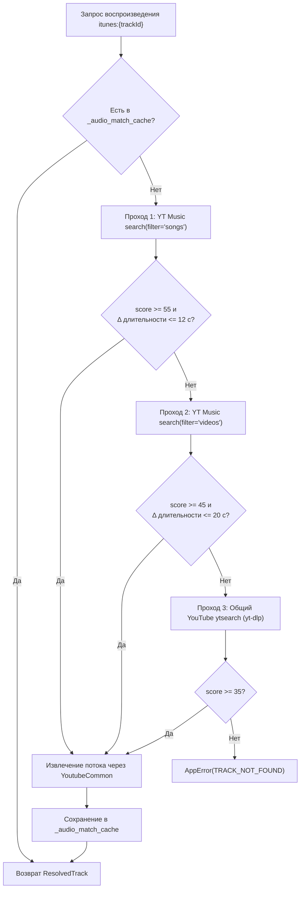

# Провайдеры iTunes Catalog и SoundCloud

[← Провайдеры YouTube](youtube.md) · [К оглавлению](../README.md) · [Далее: Миксы по настроению и энергия →](../services/mood-and-energy.md)

---

## 1. `ITunesCatalogProvider` (`music_resolver/providers/itunes_catalog.py`)

Провайдер каталога Apple Music / iTunes (`name = "itunes"`). Использует публичные эндпоинты `https://itunes.apple.com/search` и `https://itunes.apple.com/lookup` с регионом `country=RU`.

### Роль в архитектуре
1. **Витрина альбомов артиста (`albums_for_artist_name`)**:
   - Находит артиста в iTunes по имени (с проверкой схожести `fuzz.ratio >= 75`) и загружает до 50 его альбомов (`entity="album"`).
   - Отфильтровывает пустые синглы (`trackCount <= 1`), сортирует релизы от новых к старым и передаёт их в карточку артиста `YoutubeMusicProvider.get_artist()`.
   - Апскейлит обложки Apple до высокого разрешения (`100x100bb` $\rightarrow$ `600x600bb`).
2. **Просмотр альбомов (`get_album`)**:
   - Позволяет открыть любой альбом с префиксом `itunes:{collectionId}` и увидеть его точный треклист.

### 3-ступенчатый алгоритм матчинга аудио (`_match_audio`)
Поскольку сам iTunes API отдаёт только 30-секундные ознакомительные фрагменты, при запуске воспроизведения трека `itunes:{trackId}` метод `_match_audio(track)` автоматически находит полную аудиодорожку в YouTube в три прохода:

---

## 2. `SoundCloudProvider` (`music_resolver/providers/soundcloud.py`)

Провайдер поиска и воспроизведения из SoundCloud (`name = "soundcloud"`):
- **Поиск (`search`)**: выполняет быстрый плоский поиск `scsearch{limit}:{query}` через `yt-dlp` (`extract_flat=True`), собирая метаданные треков без лишних сетевых запросов к каждому потоку.
- **Резолвинг (`resolve_by_id` / `resolve_by_url`)**: извлекает прямую ссылку на аудиопоток (`mp3` / `opus`) со страницы трека на `soundcloud.com`, выбирая лучший аудиоформат по `abr`/`tbr`.
- Особенно полезен для поиска андеграундной электроники, фонка, диджей-сетов и независимых релизов, которых нет на YouTube.
